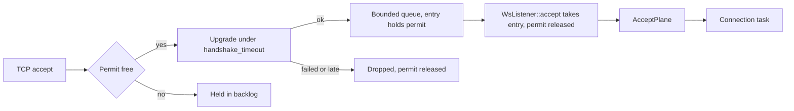
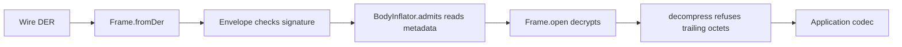
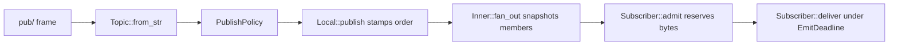

# Remediation plan

Base: `c04b90f` on `master`. Reader: the engineer who implements it. The work is three PRs, and each lettered step is one commit.

## Architecture Plan

### Prior contract

The whole-repo review after PR #25 produced 83 findings. This plan covers the code. Tooling findings are out of scope on the owner's instruction: `S3`, `S13`, `S14`, `C10`, `C23`, `C24`, `C25`, `F1`, `F2`, `F4`, `F5`, `F6`, `F10`, `T5`.

This plan keeps the crate and package topology, the `Backplane`, `DeliveryPolicy`, and `SubscribePolicy` seams, the capability interfaces in `ws/client`, and `AcceptPlane` as the accept loop.

A step MUST start by reproducing each `reviewer` claim it carries, under the Evidence Protocol. A claim that does not reproduce is dropped, with the reason in the commit body.

### Requirements

Ids come from the review. `T6` is an addition this design needs.

| Id | What MUST hold | Grade | Step | Satisfied by |
| --- | --- | --- | --- | --- |
| S1 | A stalled upgrade delays no other connection | ran | 1a | `Acceptor::run`, `WsListener::accept` |
| S2 | A failed upgrade never reaches `AcceptPlane` as an accept failure | read | 1a | `Acceptor::run` |
| S4 | Bytes queued per connection are bounded, and each emit has a deadline | read | 3b | `ConnectionBudget`, `EmitDeadline`, `Subscriber::deliver` |
| S5 | Topic length and the counter set are bounded | read | 3b | `Topic::MAX_LEN`, `Local::with_max_topics` |
| S6 | A per-request refusal leaves the demo relay running | read | 3b | `RelayBackplane::run` |
| S7 | The README states the pre-handshake message ceiling | reviewer | 1a | `ws/tightbeam-ws/README.md` |
| S8 | TS inflation admits what Rust admits | ran | 3d | `BodyInflator.admits`, `ZstdCompression.decompress` |
| S9 | The README states the origin rule for a reachable listener | reviewer | 1a | `ws/tightbeam-ws/README.md` |
| S10 | The demo registers each mutual-auth peer under its identity | reviewer | 3a | `PubsubCommands::serve_as` |
| S11 | A route can require authenticity before decode | reviewer | 3d | `Route.sealed` |
| S12 | Secret bytes are wiped at the wasm boundary, and TS keys release on demand | reviewer | 3c, 3d | `Aes256GcmKey::new`, `free` |
| C1 | Orders stay dense per topic across every node | read | 3b | `TopicRegistry::quiesce` |
| C2 | `dropped` counts updates a peer refused or a renewal held up, and other local faults end the lane | read | 3b | `Subscriber::deliver`, `TransportError::transit_status` |
| C3 | One decider owns the version floor, and it agrees with the engine | read | 3d | `FrameConfig::effective_version` |
| C4 | An omitted `order` takes a default from `FrameConfig`, because the engine has no clock on wasm32 | read | 3c | `FrameConfig.order` |
| C5 | The keepalive interval derives from the link's operation timeout | read | 3a | `MuxHandle::keep_alive` |
| C6 | A freed client closes its socket and ends its tasks | read | 3c | `MuxWsClient::drop` |
| C7 | asn `SequenceOf` and `SetOf` round-trip every length der decodes | read | 1b | `FieldKind::quote_from_value` |
| C8 | asn refuses nested `Option` at compile time | read | 1b | `FieldKind::try_from` |
| C9 | A JS value becomes bytes only when it is a `Uint8Array` | read | 3c, 3f | `JsBytes` |
| C11 | A client constructs under a CSP without `unsafe-eval` | reviewer | 3c | `Serving` |
| C12 | A busy stream reports busy, not closed | reviewer | 3c | `Slot` |
| C13 | One decider settles a JS return that may be a promise | reviewer | 3c | `settle` |
| C14 | `DeliveryPolicy::on_full` runs with no registry lock held | reviewer | 3b | `Subscriber::admit` |
| C15 | A closed subscriber has no live drain task | read | 3b | `Lane`, `Subscriber::close` |
| C16 | Zero capacities do not compile | reviewer | 3b | `RegistryOptions` |
| C17 | `unsubscribe` follows a pending `sub/` | reviewer | 3b | `SubscriptionManager.unsubscribe` |
| C18 | A consumed `FrameView` cannot return values | reviewer | 3c, 3f | `FrameAssembly`, which replaced `FrameView` |
| C19 | `DemoPaywall` refuses a client that requests no budgets | reviewer | 3e | `DemoPaywall::authorize` |
| C20 | asn date docs state the der subset | reviewer | 1b | `asn/tightbeam-asn/README.md` |
| C21 | asn refuses generics and non-field `Choice` payloads at derive time | reviewer | 1b | `FieldKind::try_from`, `AsnCodec` |
| C22 | An asn JS failure names its field | reviewer | 1b | `FieldError` |
| C26 | No doc names a symbol or variable that does not exist | reviewer | 1b, 3d | Deletions and doc corrections |
| D1 | `Frame` decides how its own body opens | read | 3d | `Frame.open` |
| D2 | TS domain verbs sit on owners, and `frame()` has one home | reviewer | 3d | `Route`, `Router`, `MessageCodec.wrapping` |
| D3 | `FrameSpec` values parse once at the `with*` seam | read | 3d | `Salt`, `Oid` |
| D4 | Dial options parse once, and mutual-only fields are unreachable on `connect` | reviewer | 3d | `Dial`, `MutualConnectOptions` |
| D5 | A `Frame` holds well-formed DER from construction | reviewer | 3d | `Frame.fromDer` |
| D6 | One owner compares digests and algorithm ids | reviewer | 3d | `DigestInfo`, `SealedPieces.requireAlgorithm` |
| D7 | A released client reads one snapshot | reviewer | 3d | `SocketLifecycle` |
| D8 | Same-type security arguments cannot swap | read | 3c, 3d | `MutualIdentity`, `Opening.fromParts`, `SealedBody` |
| D9 | The signature profile is a fact of the engine, not of `Signatory` | read | 3d | `Signatory` |
| D10 | Splitting a mux is generic over the provider | read | 3c | `BrowserMux::split` |
| D11 | The adopt-only `Protocol` contract is stated on the impl | read | 3c | `BrowserSocket` |
| D12 | A dial honors the endpoint's ceilings | read | 3a | `Protocol::connect_within` |
| D13 | Wasm serve state has no illegal combination | reviewer | 3c | `Serving` |
| D14 | No public pass-through functions remain | reviewer | 3a, 3c | Deletions, `BrowserSocket::pinned` |
| D15 | Mux negotiation and key match have one decider each | reviewer | 3c | `TcpTransport::into_mux`, `SigningIdentity::with_provider` |
| D16 | `from_encoded` decodes once | reviewer | 3c | `ClusterWorkRequest::from_encoded` |
| D17 | Echo policy has one owner and no prefix test | reviewer | 3e | `EchoBody`, `EchoCommand` |
| D18 | Pubsub orchestration sits on `PubsubCommands` | reviewer | 3a | `PubsubCommands::serve` |
| D19 | Payload shape is one interface with two kinds | reviewer | 3d | `PayloadShape` |
| D20 | Subscription mode changes through transitions | reviewer | 3b | `Entry` |
| D21 | The last order has one home | reviewer | 3b | `Backplane::last_order` |
| D22 | Fan-out pushes run outside the registry lock | reviewer | 3b | `Inner::fan_out` |
| D23 | asn has one conversion path, one emitter, and a private expansion surface | reviewer | 1b | `FieldKind::quote_from_value`, `__private` |
| D24 | Emitted asn types are checked types | reviewer | 1b | `AsnCodec` derive |
| D25 | Published asn defaults name no consumer | reviewer | 1b | `EmitOptions::new` |
| D26 | `FrameCodec` names a second kind or collapses, and `index.ts` is a barrel | reviewer | 3d | `ws/client/src/client.ts` |
| F3 | Demo payment and budget ceiling have one home in test code | reviewer | 3e | One shared `env.ts` |
| F7 | asn emitted modules typecheck against the real `MessageCodec` | reviewer | 1b | `asn/tests` |
| F8 | Each wasm table has one home | reviewer | 3c | `GoAwayReason` labels from T3 |
| F9 | One fixtures home per stack | reviewer | 3e | `tests/fixtures.ts`, `testing::colony` |
| F11 | asn has no dev-dependency cycle | reviewer | 1b | `asn/tightbeam-asn/tests/fixtures` |
| F12 | Native and wasm adapters share one algorithm | reviewer | none | Named blocker in `### Complexity Tracking` |
| T1 | `MuxHandle` owns its keepalive | read | 2 | `MuxHandle::keep_alive` |
| T2 | `Frame` owns installing detached artifacts and the commitment preimage | reviewer | 2 | `Frame::with_*`, `CommitmentSalt::preimage` |
| T3 | Enum inverses and labels live on the enums | reviewer | 2 | `FromStr`, and the `TryFrom<u8>` that the `Enumerated` derive gives |
| T4 | The opaque body and the colony wire types are public without tokio | reviewer | 2 | `tightbeam::Opaque`, `colony-wire` |
| T6 | A dial receives the endpoint limits | added | 2 | `Protocol::connect_within` |

### Reuse

- `tightbeam::transport::accept::AcceptPlane` stays the accept loop.
- `tightbeam::constants::DEFAULT_MAX_SERVER_CONNECTIONS` sizes the pending-upgrade semaphore and the finished queue.
- `TransportLimits::handshake_timeout` is the upgrade deadline.
- `GatedField::since` and `Version::later` (`tightbeam-rs-0.17.0/src/version.rs:38,89`) decide the version floor.
- `TransportError::transit_status` (`tightbeam-rs-0.17.0/src/transport/error.rs:424`) decides what a peer caused.
- `CommitmentSalt::parse` (`tightbeam-rs-0.17.0/src/crypto/commitment.rs:77`) stays the salt rule that `Salt.parse` reaches through wasm.
- `SigningIdentity::with_provider` and `TcpTransport::into_mux` replace the local pre-checks in D15.
- `SocketMonitor::close` (`ws/tightbeam-ws-wasm/src/socket.rs:82`) closes the socket for C6.
- `Protocol::connect_within` (`tightbeam-rs-0.17.0/src/transport/protocols.rs:213`) carries the dial. It takes a `Duration` today, so T6 changes its parameter to `&CheckedLimits` and adds no second method.
- none: a conversion failure that names its field path. `der::Error` carries a byte position, and `TransportError` is a transport type.
- none: an upstream keepalive. Searched `src/transport/multiplex` and `src/constants.rs`, and only the one-shot `MuxHandle::ping` exists.
- none: a public install of detached artifacts. `attach_signer_info` (`src/frame/signature.rs:164`) covers the signature only, and `Frame` otherwise has getters.
- none: a public commitment preimage. `CommitmentSalt::commit` streams into a hasher and is `pub(crate)`, and the wasm crate needs the bytes.
- none: a public opaque body. No such type exists in 0.17, and two crates define `OpaqueBody`.
- none: a tokio-free colony wire feature. `colony` requires `tokio` (`Cargo.toml:82`).

### Impact map

`ws/tightbeam-ws`, `ws/tightbeam-ws-wasm`, `ws/client`, `ws/tests`, `pubsub/tightbeam-pubsub`, `pubsub/client`, `pubsub/tests`, `asn/*`, the root `Cargo.toml`, and in PR 2 only, `~/projects/tightbeam`.

### Components

#### Acceptor

Responsibility: Run WebSocket upgrades apart from the accept loop.
Dependencies: `WsListener` owns it. It depends on `tokio`, `tokio-tungstenite`, and `TransportLimits`.
Encapsulation / ISP: Hides the task, the semaphore, and the finished queue. `WsListener::accept` sees finished sockets only.

#### Pubsub bounds

Responsibility: Bound queued bytes, topics, and counters, and keep orders dense.
Dependencies: `TopicRegistry` depends on `Backplane` and `DeliveryPolicy`. Nothing depends the other way.
Encapsulation / ISP: `Local` hides the counter map and eviction. `ConnectionBudget` hides the byte count. `Lane` hides the drain task.

#### Wasm boundary

Responsibility: Turn JS values into checked Rust values once.
Dependencies: `bindings.rs`, `mux.rs`, `streaming.rs`, and `approver.rs` depend on `promise.rs`.
Encapsulation / ISP: `promise.rs` hides JS value shapes. `Serving` hides responder and mode pairing. `MuxWsClient` hides its tasks.

#### TS frame model

Responsibility: Own how a frame parses, opens, and states its version.
Dependencies: `Envelope` and `Router` depend on `Frame`. `Frame` depends on the wasm composer and `Hasher`.
Encapsulation / ISP: `Frame` hides decoded state. `Salt` and `Oid` hide validation. `Dial` hides option shapes.

### Public Surface

| Symbol | Kind | Module | Step |
| --- | --- | --- | --- |
| `WsListener` | struct | `ws/tightbeam-ws/src/protocol.rs` | 1a |
| `__private`, `FieldError` | struct | `asn/tightbeam-asn/src/lib.rs` | 1b |
| `AsnCodec` | trait | `asn/tightbeam-asn/src/lib.rs` | 1b |
| `EmitOptions::new` | method | `asn/tightbeam-asn/src/emit.rs` | 1b |
| `MuxHandle::keep_alive` | method | tightbeam `src/transport/multiplex/router/handle.rs` | 2 |
| `Protocol::connect_within` | method | tightbeam `src/transport/protocols.rs` | 2 |
| `ConnectionBuilder::with_limits` | method | tightbeam `src/transport/client/mod.rs` | 2 |
| `Frame::with_body`, `with_message_integrity`, `with_compactness`, `with_confidentiality`, `with_frame_integrity`, `witness_preimage` | method | tightbeam `src/frame/install.rs` | 2 |
| `InstallStep`, `TightBeamError::InstallOutOfOrder` | enum | tightbeam `src/frame/install.rs`, `src/error.rs` | 2 |
| `CommitmentSalt::preimage`, returning `SecretSlice<u8>` | method | tightbeam `src/crypto/commitment.rs` | 2 |
| `FromStr` for `TransitStatus`, `GoAwayReason`, with `UnknownName` | method | tightbeam `src/policy.rs`, `src/transport/envelopes.rs`, `src/error.rs` | 2 |
| `tightbeam::Opaque` | struct | tightbeam `src/opaque.rs` | 2 |
| `colony-wire`, with `ClusterWorkRequest` and `ClusterWorkResponse` | const | tightbeam `Cargo.toml` feature, `src/colony/work.rs` | 2 |
| `EnvelopeSink::clock`, `EnvelopeSink::limits` | method | tightbeam `src/transport/io.rs` | 2 |
| `PubsubCommands::serve`, `serve_as` | method | `pubsub/tightbeam-pubsub/src/dispatch.rs` | 3a |
| `Topic::MAX_LEN` | const | `pubsub/tightbeam-pubsub/src/topic.rs` | 3b |
| `TopicError::TooLong` | enum | `pubsub/tightbeam-pubsub/src/topic.rs` | 3b |
| `RegistryOptions` | struct | `pubsub/tightbeam-pubsub/src/registry.rs` | 3b |
| `EmitDeadline` | struct | `pubsub/tightbeam-pubsub/src/registry.rs` | 3b |
| `Local::with_max_topics` | method | `pubsub/tightbeam-pubsub/src/backplane.rs` | 3b |
| `UpdateSink::has_members` | method | `pubsub/tightbeam-pubsub/src/backplane.rs` | 3b |
| `BackplaneError::TopicLimit` | enum | `pubsub/tightbeam-pubsub/src/backplane.rs` | 3b |
| `FrameConfig` | struct | `ws/tightbeam-ws-wasm/src/build.rs` | 3c |
| `BrowserMux` | trait | `ws/tightbeam-ws-wasm/src/mux.rs` | 3c |
| `BrowserSocket::pinned`, `trust_store` | method | `ws/tightbeam-ws-wasm/src/protocol.rs` | 3c |
| `settle` | util | `ws/tightbeam-ws-wasm/src/promise.rs` | 3c |
| `GoAwayReason` | type | `ws/client/src/index.ts` | 3c |
| `Frame.open`, `Frame.fromDer` | method | `ws/client/src/frame.ts` | 3d |
| `DigestInfo` | class | `ws/client/src/frame.ts` | 3d |
| `Salt` | class | `ws/client/src/commitment.ts` | 3d |
| `Oid` | class | `ws/client/src/crypto.ts` | 3d |
| `Signatory` | interface | `ws/client/src/crypto.ts` | 3d |
| `free` on `Secp256k1SigningKey`, `HpkeDecryptor`, `Aes256Gcm` | method | `ws/client/src/crypto.ts` | 3d |
| `Dial` | class | `ws/client/src/client.ts` | 3d |
| `MutualConnectOptions`, `MutualIdentity` | interface | `ws/client/src/client.ts` | 3d |
| `BodyInflator.admits` | method | `ws/client/src/compress.ts` | 3d |
| `Router`, `Route` | class | `ws/client/src/router.ts` | 3d |
| `PayloadShape` | interface | `pubsub/client/src/manager.ts` | 3d |
| `EchoBody`, `EchoCommand` | enum | `ws/tightbeam-ws/src/testing/mux.rs` | 3e |
| `EmitFault` | enum | `pubsub/tightbeam-pubsub/src/emit.rs` | 3b |
| `MuxTasks` | struct | `ws/tightbeam-ws-wasm/src/mux.rs` | 3c |
| `colony` feature, with `Identity::{cluster_config, hive_config, servlet_config}` | method | `ws/tightbeam-ws/src/testing/colony.rs` | 3e |
| `Unrouted`, `AppRoutes::route` | struct | `pubsub/tightbeam-pubsub/src/serve.rs` | 3f |
| `testing::OpaqueFrame`, `Topic::fixture` | struct | `pubsub/tightbeam-pubsub/src/testing.rs` | 3f |
| `Backplane::vacated`, required of every backplane | method | `pubsub/tightbeam-pubsub/src/backplane.rs` | 3f |
| `RegistryView`, passed to every policy method | struct | `pubsub/tightbeam-pubsub/src/registry.rs` | 3f |
| `NodeSink`, which `Backplane::attach` takes | struct | `pubsub/tightbeam-pubsub/src/backplane.rs` | 3f |
| `ServerLink`, which `serve` and `serve_as` take | struct | `pubsub/tightbeam-pubsub/src/link.rs` | 3f |
| `SettledEmit` | trait | `pubsub/tightbeam-pubsub/src/emit.rs` | 3f |
| `CommandAnswer` | struct | `pubsub/tightbeam-pubsub/src/dispatch.rs` | 3f |
| `testing::MemoryLink` | struct | `pubsub/tightbeam-pubsub/src/testing.rs` | 3f |
| `testing::{EnvVar, EnvError, Pinned}` | struct | `ws/tightbeam-ws/src/testing` | 3f |
| `CodecPairs`, `EmitOptions::emit` | struct | `asn/tightbeam-asn/src/emit.rs` | 3f |
| `BodyDer`, `NamedDigest`, `Compactness`, `SignerKeyId`, `FrameSignature`, `SharedKey`, `FrameConfig::assemble` | struct | `ws/tightbeam-ws-wasm/src/build.rs` | 3f |
| `FrameAssembly`, `CommitmentSalt` (wasm classes), `checkOid` | struct | `ws/tightbeam-ws-wasm/src/bindings.rs` | 3f |
| `Refusal`, `JsFault` | enum | `ws/tightbeam-ws-wasm/src/fault.rs` | 3f |
| `Dial` | enum | `ws/tightbeam-ws-wasm/src/secure.rs` | 3f |
| `JsBytes`, `JsOid` (crate-private) | struct | `ws/tightbeam-ws-wasm/src/promise.rs` | 3f |
| `GoAwayLabel` | enum | `ws/tightbeam-ws-wasm/src/goaway.rs` | 3f |
| `Version`, `MessagePriority` (wasm enums) | enum | `ws/tightbeam-ws-wasm/src/metadata.rs` | 3f |
| `OpaqueBody`, `DottedOid`, `Profile` (wasm classes) | struct | `ws/tightbeam-ws-wasm/src/bindings.rs` | 3f |
| `FrameBuilder.of`, `TightbeamWsClient.init`, `Frame.fromResponseDer` | method | `ws/client/src` | 3f |
| `ClientTransportError.{closed, isTransportError, isConnectionClosed}` | method | `ws/client/src/errors.ts` | 3f |
| `SharedKey`, `MutualIdentity` | interface | wasm ABI, `ws/client/src/crypto.ts`, `ws/client/src/client.ts` | 3f |
| `Envelope.over` | method | `ws/client/src/envelope.ts` | 3f |
| `FrameFields` | class | `ws/client/src/frame.ts` | 3f |
| `Topic`, `TopicError`, `TopicErrorCode` | class | `pubsub/client/src/topic.ts` | 3f |
| `ChunkSource` | class | `ws/client/src/chunks.ts` | 3f |
| `Salt.preimage` | method | `ws/client/src/commitment.ts` | 3f |

`testing::MemoryLink` replaces `memory_mux_pair` in 3f. Its `mux_pair` takes `MuxSettings`, so a test can set a send budget, and its clock is the link clock.

`GoAwayReason` values change from PascalCase to the upstream `as_str` labels, which is a public TS break.

Removed from the public surface: `serve_connection`, `serve_connection_as`, `keep_alive`, `KEEPALIVE_INTERVAL`, `opaque_payload`, `Backplane::reserve_order`, `assemble_mux`, `serve_handshake`, `build_transport_with`, `profile_trust_store`, `split_mux`, `effectiveVersion`, `route`, `router`, `wrapped`, `Signatory.signatureAlgorithmOid`, `Signatory.digestAlgorithmOid`, and in 3f `unrouted`, `testing::command_frame`, `testing::sealed_command_frame`, `tightbeam_ws::mux`, the `build::` free functions, `connectMutualWithSigner`, `FrameView`, `inspectFrame`, `inspectFrameFields`, `setMessageIntegrity`, `setConfidentiality`, `setCompactness`, `witnessInput`, `attachWitness`, `tbsBytes`, `signingPrehash`, `signaturePrehash`, `attachSignature`, `commitmentPreimage`, `saltRefusal`, `oidRefusal`, `SealedPieces`, `bytes_from_js`, `envelope`, `assertTopic`, `frame`, `initClient`, `connectionClosed`, `isTransportError`, `versionFromOrdinal`, `priorityFromOrdinal`, `bodyPreimage`, `decodeBody`, `checkOid`, `profileOids`, `WeakTopicRegistry`, `TopicRegistry::downgrade`, `memory_mux_pair`, `EmitFault::emit_until_settled`, `env_u32`, `pinned_trust`, `paywall_enabled`, `budget_ceiling`, `discover_pairs`, `emit_codecs_ts`, `emit_from_paths`, and `__private::Js`.

Removed internally: `deliver`, `drain`, `remove_subscriber`, `Inner::push`, `TopicState.last_order`, and the wasm `keep_alive` and `KEEPALIVE_INTERVAL`.

`wrapped` has call sites outside `ws/client`: `pubsub/client/README.md` and `pubsub/tests/app/main.ts` change with it.

### Behaviors

| Behavior | Owning type | Method | State it decides on |
| --- | --- | --- | --- |
| Hand over a finished upgrade | `WsListener` | `accept` | `Acceptor.finished` queue |
| Build a listener | `WsListener` | `from_listener` | The bound `TcpListener` |
| Run an upgrade under its deadline | `Acceptor` | `run` | `Acceptor.pending` permits |
| End the task with its listener | `Acceptor` | `drop` | `Acceptor.task` handle |
| Convert a field | `FieldKind` | `quote_from_value`, `quote_to_value` | The `FieldKind` variant |
| Refuse an unsupported shape | `FieldKind` | `try_from` | The field `Type` |
| Name a failed field | `FieldError` | `new` | The field path and expected kind |
| Ping inside the deadline | `MuxHandle` | `keep_alive` | `MuxLink` clock and operation timeout |
| Install a detached artifact | `Frame` | `with_*` | `Frame` metadata |
| Serve one connection | `PubsubCommands` | `serve`, `serve_as` | `PubsubCommands.registry` |
| Parse a topic name | `Topic` | `from_str` | The name, against `Topic::MAX_LEN` |
| Sequence one publish | `Local` | `publish` | `Local.orders` |
| Evict a dead counter | `Local` | `evict_for` | `Local.orders`, through `UpdateSink::has_members` |
| Report live members | `Inner` | `has_members` | `TopicState.members` |
| Fan out after the lock | `Inner` | `fan_out` | A member snapshot |
| Reserve queued bytes | `ConnectionBudget` | `reserve` | `ConnectionBudget.queued` |
| Return queued bytes | `ByteReservation` | `drop` | The reserved length |
| Admit an update to a lane | `Subscriber` | `admit` | `Subscriber.lane` |
| Deliver one update | `Subscriber` | `deliver` | `Subscriber.dropped`, the emit outcome |
| Stop draining | `Subscriber` | `close` | The `Lane` variant |
| Finish every topic | `TopicRegistry` | `quiesce` | `Inner.draining`, `Backplane::last_order` |
| Survive a refusal | `RelayBackplane` | `run` | The emit outcome |
| Move subscription mode | `Entry` | `goLive`, `park`, `end` | `Entry.mode` |
| Remove a subscription | `SubscriptionManager` | `unsubscribe`, `complete` | `SubscriptionManager.entries` |
| Order the commands of a topic | `SubscriptionManager` | `command` | `SubscriptionManager.tails` |
| Close on free | `MuxWsClient` | `drop` | `MuxWsClient.monitor` |
| Claim the serve mode | `Serving` | `claim` | The `Serving` variant |
| Lend a stream handle | `Slot` | `lend` | The `Slot` variant |
| Refuse an empty grant | `DemoPaywall` | `authorize` | The offer's `requested_budgets` |
| Pick the echo handler | `EchoBody` | `serve` | The `EchoBody` variant |
| Compute the version floor | `FrameConfig` | `effective_version` | `FrameConfig` declared `GatedField` set |
| Open a body | `Frame` | `open` | `Frame.confidential`, `Frame.compressed` |
| Parse a frame | `Frame` | `fromDer` | The input DER |
| Judge a digest | `DigestInfo` | `verdict` | `DigestInfo.algorithmOid`, `.digest` |
| Check a sealed algorithm | `SealedPieces` | `requireAlgorithm` | `SealedPieces.algorithmOid` |
| Parse a salt | `Salt` | `parse` | The input bytes |
| Parse dial options | `Dial` | `parse` | The input options |
| Admit compactness metadata | `ZstdCompression` | `admits` | The carried OID, parameters, and content type |
| Refuse trailing octets | `ZstdCompression` | `decompress` | The decrypted zstd bytes |
| Read client state | `SocketLifecycle` | `view` | `SocketLifecycle.state` |
| Build or decode a payload | `PayloadShape` | `build`, `decode` | none: pure mapping, with `Envelope` and a codec adapter as its two kinds |

`Local::publish` and its eviction run as one transaction under the `Local` lock.

### Invariants and States

| Invariant | Enforced by | Grade | Blocker |
| --- | --- | --- | --- |
| A dropped listener has no acceptor task | `Acceptor` aborts its task on drop | Proven | none |
| `accept` returns only an upgraded socket | The queue entry type holds an upgraded stream | Proven | none |
| Pending plus finished sockets stay under the cap | Each queue entry holds its `OwnedSemaphorePermit` until `accept` takes it | Proven | none |
| A topic name fits `Topic::MAX_LEN` | `Topic::from_str` | Proven | none |
| A queued update holds its byte reservation | Lane entries carry `ByteReservation` | Proven | none |
| Registry capacities are at least one | `NonZeroUsize` | Proven | none |
| An emit deadline is above zero | `EmitDeadline::new` | Proven | none |
| A closed lane has no drain task | The `Lane` variant owns the abort handle | Proven | none |
| A freed client has no socket | `MuxWsClient::drop` | Proven | none |
| A salt meets the 16-octet rule | `Salt.parse`, with `Opening.fromParts` and `messageCommitmentVerdict` taking `Salt` | Proven | none |
| A `Frame` holds parsed DER | `Frame.fromDer` | Proven | none |
| Serve state has one mode | `Serving` | Proven | none |
| A counter leaves only with no live member | `Local::evict_for` | One shared guard | `Local` alone holds the map, so the path is single |
| Pre-handshake messages stay under 16 KiB | Nothing at the socket | Convention | tokio-tungstenite 0.30 exposes `get_config` only (`src/lib.rs:284`) |

| Type | Representable but invalid | Closed by |
| --- | --- | --- |
| `FrameConfig.order` | `0` standing for unset | `Option<u64>` |
| `MuxWsClient` serve fields | `(Some, Some)`, `(None, None)`, and an inert handler | `Serving::Idle(MuxResponder)` or `Started { mode, handler }` |
| `RegistryOptions` counts | `0` | `NonZeroUsize` on all three counts |
| `Subscriber` flags | `closed` with a live task, and `closed` with `finished` | `Lane::Open`, `Finishing`, or `Closed` |
| `Entry` | In the map with mode ended | `SubscriptionManager` runs `end` and the delete together |
| `SequenceOf` guard | Length below N rejected | Guards deleted |
| `FieldKind` | `Option` inside `Option` or `Vec` | Span error in `FieldKind::try_from` |
| `FrameView` | Consumed yet readable | Removed in 3f: `FrameAssembly` holds the parsed frame |
| `ConnectOptions` | Mutual-only fields on `connect` | `MutualConnectOptions` |
| `MutualIdentity` | Certificates swapped | Named fields |
| `PayloadShape` | none: it holds no state | Not applicable |
| `Acceptor`, `Slot`, `Salt`, `Oid`, `DigestInfo`, `Dial`, `ConnectionBudget` | none: each is built by one parse or one owner | Not applicable |

| Knowledge | Kind | Canonical home |
| --- | --- | --- |
| Upgrade deadline | fact | `TransportLimits::handshake_timeout` |
| Keepalive interval | fact | A third of `TransportLimits::operation_timeout` |
| Version floor | decision | `GatedField::since` |
| Which failures a peer caused | decision | `TransportError::transit_status` |
| Topic length ceiling | fact | `Topic::MAX_LEN` |
| Last committed order | fact | `Backplane::last_order` |
| JS byte decoding | boundary | `JsBytes` |

Tripwires to delete: `echo_command_prefixes_do_not_overlap`, the `tests/fixtures_dx.rs` fragment check, and `ws/tightbeam-ws-wasm/tests/work_codec.rs` once `colony-wire` lands.

### Decisions

#### Where upgrades run

| Approach | How it works | Advantage | Disadvantage |
| --- | --- | --- | --- |
| A: Acceptor task | A task owned by `WsListener` accepts TCP, upgrades each socket under a deadline, and queues finished sockets | `AsyncListenerTrait::accept` keeps its contract, and transports do not change | Adds a task, which the listener must own |
| B: Lazy upgrade | `accept` returns at TCP accept, and `WsStream` upgrades on first read | The plane's permit covers each pending upgrade | `WsStream` gains a mode, and `into_split` would have to become async |
| C: Poll in `accept` | `accept` polls TCP and pending upgrades together | No task | Upgrades stop while the plane sits at its cap |

Recommendation: A. Every bind goes through `WsListener::from_listener`, which captures `local_addr` and spawns the task. The queue is a bounded channel behind `tokio::sync::Mutex`, because `accept` takes `&self`. Each entry holds its permit, so a full `AcceptPlane` stops new upgrades. A TCP accept failure goes through the same bounded send, so the plane's backoff still paces it.

#### How the counter set stays bounded

| Approach | How it works | Advantage | Disadvantage |
| --- | --- | --- | --- |
| A: Hard cap | Refuse new topics at the cap | Smallest change | A full map refuses new topics until restart |
| B: Forget on last unsubscribe | The registry tells the backplane when a topic empties | Counters track subscribers exactly | Inverts the lock order |
| C: Evict at the cap | On the first publish of a new topic at the cap, `Local` evicts the first topic with no member on any sink, and refuses only when every topic is live | Refusal means real capacity, and the lock order `Local` then state holds | Changes the documented lifetime of a counter |

Recommendation: C. A restarted counter classifies `fresh`, because eviction needs no member on any sink, `reattach` resets the gate, and `subscribe` builds a new `TopicGate`. The `backplane.rs` contract text changes with it.

#### What a full byte budget does

| Approach | How it works | Advantage | Disadvantage |
| --- | --- | --- | --- |
| A: Lane ceiling | Each lane counts its own bytes | No shared state | Total per connection scales with lanes |
| B: Connection budget | `ConnectionBudget` is an atomic count, and lanes hold a `ByteReservation` | One bound per connection, released on drop with no lock | `DropOldest` on one lane may free too little |

Recommendation: B. `Subscriber::admit` treats a refused reservation like a full queue and asks `on_full` with no lock held. `DropOldest` drops one entry and retries once, and a second refusal acts as `DropNew`.

#### Whether the server checks `Origin`

| Approach | How it works | Advantage | Disadvantage |
| --- | --- | --- | --- |
| A: Allowlist API | `accept_hdr_async_with_config` with configured origins | Closes browser access to loopback listeners | New config surface, and non-browser clients ignore it |
| B: Document | The README states that mutual auth is the access control | No new surface | Cleartext loopback listeners stay reachable from pages |

Recommendation: B. No ambient credential exists, so a page gains anonymous access only.

#### Where the version floor lives

| Approach | How it works | Advantage | Disadvantage |
| --- | --- | --- | --- |
| A: Correct the TS table | Change V2 to V1 in `requiredVersion` | One line | Two deciders remain |
| B: Decide in Rust | `FrameComposer` receives the declared `GatedField` set, and `FrameConfig` computes the floor | One decider, derived from the engine | `assertVersion` moves into `build()`, which is already async |

Recommendation: B.

#### When tightbeam changes land

| Approach | How it works | Advantage | Disadvantage |
| --- | --- | --- | --- |
| A: Before pubsub | PR 2 releases 0.18, then PR 3 moves pubsub | Procedures move before any step edits them | Pubsub bounds wait on a release |
| B: After everything | Local fixes first, then a sweep | No wait | `serve_connection` and both keepalive copies get edited twice |

Recommendation: A, by the rule that a procedure in reach moves first.

### Data Flow

Parse point for every inbound socket: the `Acceptor` upgrade.

Parse point for every inbound frame in TS: `Frame.fromDer`.

Parse point for every publish: `Topic::from_str`.

### Design Principle Validation

- Encapsulation: each component names its secret, and removed functions move to owners.
- Single responsibility: `index.ts` splits into a barrel and `client.ts`. `Envelope` keeps policy, and `Frame` keeps mechanics.
- Open to extension: `PayloadShape` replaces two kind matches.
- Substitutability: `WsListener` keeps the `AcceptPlane` failure contract. `BrowserSocket` states its narrower contract.
- Interface segregation: `MutualConnectOptions` splits mutual fields from `ConnectOptions`. `Signatory` loses two unused fields.

### Phases

| Phase | Goal | Components and files | Acceptance criteria served | Depends on | PR-ready because |
| --- | --- | --- | --- | --- | --- |
| 1 | Fix what needs no tightbeam change | `ws/tightbeam-ws`, `asn/*` | AC1, AC2 | None | Each step ships with its tests |
| 2 | Add tightbeam seams and release 0.18 | `~/projects/tightbeam` | AC3 | None | A tightbeam release under its own CI |
| 3 | Adopt 0.18, bound pubsub, and move decisions to owners | root `Cargo.toml`, `ws/*`, `pubsub/*` | AC4, AC5, AC6, AC7, AC8 | 1, 2 | Crates, wasm, and the TS client change together, so no public seam breaks across PRs |

| Step | PR | Goal | Depends on |
| --- | --- | --- | --- |
| 1a | 1 | Isolate upgrades from the accept loop | None |
| 1b | 1 | Fix the asn codec and its surface | None |
| 2 | 2 | Add seams to tightbeam | None |
| 3a | 3 | Adopt 0.18 in native crates | 2 |
| 3b | 3 | Bound pubsub and restore dense orders | 3a |
| 3c | 3 | Harden the wasm boundary | 3a |
| 3d | 3 | Move TS decisions to owners | 3b, 3c |
| 3e | 3 | Close SSOT in demo and test code | 3d |
| 3f | 3 | Close the items PR 3 found and first left out | 3e |

### Open questions

| Question | What it blocks | Default if unanswered |
| --- | --- | --- |
| [NEEDS CLARIFICATION: Move the version floor to V1, which changes wire output for hash-only frames?] | Step 3d | V1, because the engine owns that rule |
| [NEEDS CLARIFICATION: Start work in `~/projects/tightbeam`?] | PR 2 | Wait for the owner |

### Assumptions

- `Topic::MAX_LEN` is 256 octets. A longer real topic name would raise it.
- `RegistryOptions.connection_queue_bytes` defaults to `MAX_MUX_CONNECTION_REASSEMBLY_BYTES`.
- `Local::with_max_topics` defaults to 65536.
- `ws/tightbeam-ws` gains the tokio `time` and `sync` features.
- `Local` keeps its one lock, because orders and arrival must match. A measured bottleneck would reopen sharding.
- `BudgetExhausted` keeps the drop and count in `Subscriber::deliver`, because a renewal clears it. Other local failures end the lane.
- A failed upgrade is dropped silently. If operators need a count, `Acceptor` is its one home.
- `ZstdCompression.decompress` walks the frame blocks to find the frame end (RFC 8878 section 3.1.1.2), because the bundled wasm exports no frame-size call.

### Complexity Tracking

| Violation | Why the design needs it | Simpler alternative rejected because |
| --- | --- | --- |
| F12 stays open | tungstenite and gloo `Message` are separate foreign types with no shared trait | A generic core adds a crate for one match arm, so fix the `Close` arm drift alone in step 3c |
| S7 stays a documented bound | tokio-tungstenite 0.30 has no reachable `set_config` | Lowering the socket ceiling to 16 KiB refuses every post-handshake message |
| `with_timeout` keeps a raw `Duration` | Every raw timeout drains through `EndpointConfig::under` before any I/O, and `CheckedLimits` holds it past that guard | A parsed timeout type adds a public type for a zero that one guard already refuses with a typed error |

### Acceptance criteria

- AC1 (1a): `cargo test -p tightbeam-ws --features testing` passes with new tests that open a stalled socket and a failed upgrade, then complete a second client's upgrade, that fill the plane to its cap and observe a bounded queue, and that drop a listener and observe its task end.
- AC2 (1b): `make -C asn test` passes with new round-trip tests for short collections and a derive failure for nested `Option`.
- AC3 (2): `make ci` passes in `~/projects/tightbeam`, and 0.18.0 is on crates.io.
- AC4 (3a): `cargo check --workspace --all-features --all-targets` passes, and `grep` finds no `fn keep_alive` or `KEEPALIVE_INTERVAL` in `pubsub/tightbeam-pubsub/src`.
- AC5 (3b): `cargo test -p tightbeam-pubsub --features testing` passes with tests for sibling-node density, the byte budget and `DropOldest` fallback, emit deadline, topic length, and eviction. `npm --prefix pubsub test` passes.
- AC6 (3c): the wasm runtime tests pass with tests for free-then-closed and non-`Uint8Array` input.
- AC7 (3d): `npm --prefix ws test` passes with tests for trailing skippable input, swapped-argument types, and the version floor.
- AC8 (3e): `cargo test --workspace --all-features` and the TS test suites pass.

### Standards Consulted

- RFC 6455, The WebSocket Protocol, December 2011: section 10.2 informed the `Origin` decision.
- RFC 8878, Zstandard Compression, February 2021: section 3.1.2 informed S8.
- RFC 5652, Cryptographic Message Syntax, September 2009: S8 and T2.
- ITU-T X.690 (DER): C7 and C8.
- CWE-400, CWE-770, CWE-436: S1, S2, S4, S5, S8.

### Risks

- PR 2 needs the owner's release, so PR 3 waits on it. Mitigation: PR 1 lands first and carries the upgrade fix.
- Stalled upgrades can hold every permit for one `handshake_timeout`. Mitigation: the bound is the connection cap, and a shorter upgrade deadline is a one-line change.
- `Acceptor` adds a task to every listener. Mitigation: its queue holds upgraded sockets, so `P` stays out of it.
- Counter eviction changes a documented contract. Mitigation: it runs only at the cap and only for topics with no live member.
- PR 3 is the largest PR. Mitigation: its six steps are separate commits, and each passes its own criterion.
- This file names unfixed defects, and the repo is public. Mitigation: it states invariants rather than attack steps, and it stays uncommitted until the fixes land, as `SECURITY.md` asks.
