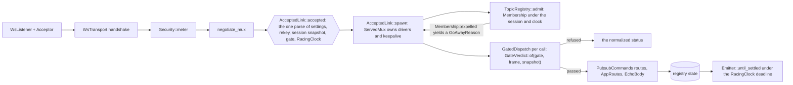
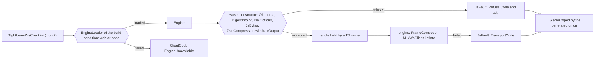
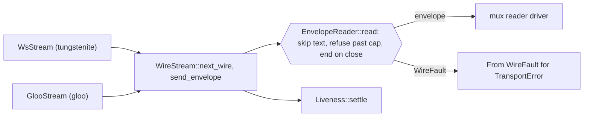
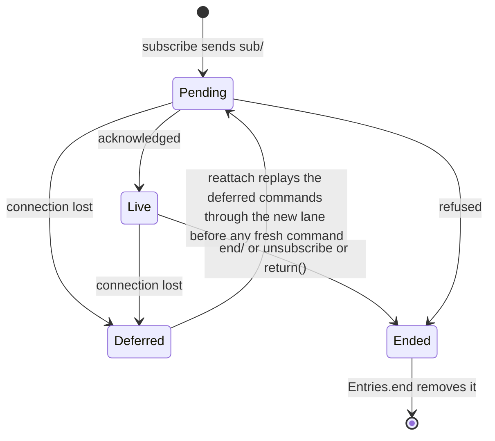
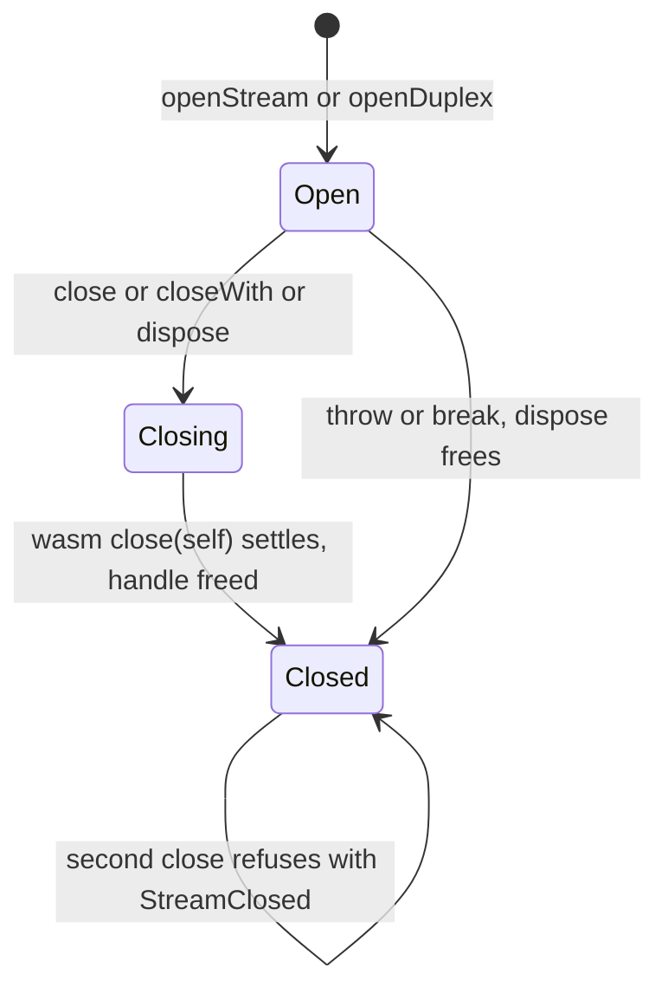
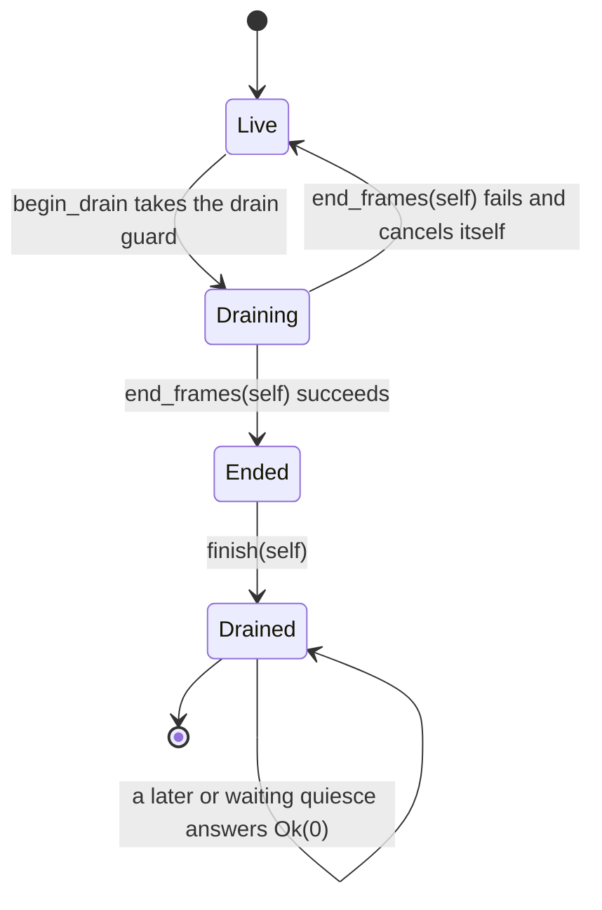

# Root-cause remediation plan

<!-- cspell:words typestate ruzstd doctest doctests rustdoc impls codegen clevels downcasting interleavings monomorphized tesler unawaited uncoded newtype -->

Base: `c04b90f` on `master`, working tree on `fix/audit-phase-1`. Input: the structural analysis `root-causes.md` (causes C1 to C10, standalone S17). Reader: the engineer who implements it. This plan replaces `docs/plans/2026-11-remediation.md` and does not extend it. Upstream paths are written `tb:` for `~/.cargo/registry/src/index.crates.io-1949cf8c6b5b557f/tightbeam-rs-0.18.0/`. Revision 2 remediates the plan-checklist and structural-audit gate reports.

## Architecture Plan

### Prior contract

- The old plan mapped each finding to one symbol, put engine-owned parses on TypeScript owners (D3, D4, D6, S8), graded runtime `Drop` as Proven, kept F12 open on "adds a crate", and split work by language. This plan drops that contract. One phase is one root cause, and it crosses the Rust, wasm, and TS seams of that cause in one owner.
- Kept as sound: `Acceptor` and `WsListener::from_listener`, the asn derive refusals (`Codec::try_from`, `FieldKind::try_from`, `Slot`, `FieldError` paths), the 0.18 adoptions (`connect_within(&CheckedLimits)`, `MuxHandle::keep_alive`, `tightbeam::Opaque`, `colony-wire`), the pubsub bounds types (`Topic::MAX_LEN`, `ConnectionBudget`, `ByteReservation`, `EmitDeadline::new`), `Lane`, `JsBytes`, `FrameAssembly`, `RegistryView`, `NodeSink`, the `Retirement` guard, counter eviction, the byte budget, the version floor in Rust (`FrameConfig::effective_version`, `build.rs:86`), and `RegistryOptions` with `NonZeroUsize`.
- Reshaped only because a cause needs it: `FrameAssembly` gains the `Signing` typestate (C1), counter eviction moves its undo onto an `Eviction` act (C8), and `RegistryView` reads a session instead of opaque identity bytes (C5).
- No `## Clarifications` section exists. No tightbeam-rs change is in scope. Each upstream blocker is named with its fail-closed ext shape.

### Reuse

- `tb:src/policy.rs:326-328` `GatePolicy::evaluate` (public) -- the gate verdict. The ext evaluates it and writes no gate rule.
- `tb:src/transport/multiplex/mod.rs:508-511`, `:541`, `:547` `GatedHalves`, `MuxAcceptor::session_context`, `MuxAcceptor::into_gated_halves` -- the gate and peer snapshot of an accepted transport.
- `tb:src/transport/multiplex/router/transport.rs:58`, `:136` `MuxTransport::new`, `with_rekey`, `:219` `spawn`, `:254` `SpawnedMux`, `:280`, `:320` `MuxDrivers` and its aborting `Drop` -- the driver owner. No hand `into_parts` plus `tokio::spawn`.
- `tb:src/transport/multiplex/router/responder.rs:342` `MuxResponder::serve_with` and `tb:src/transport/multiplex/mod.rs:746` `MuxDispatch` -- the seam the ext gate wraps.
- `tb:src/transport/multiplex/mod.rs:612-635` `MuxAcceptor::serve` -- the processor example's whole serve, and the reference side of the differential test.
- `tb:src/transport/multiplex/router/handle.rs:561` `keep_alive`, `:598` `shutdown_with`.
- `tb:src/transport/io.rs:152` `EnvelopeSink::clock`, `tb:src/clock.rs:209`, `:221` `Clock::timing`, `Timing::Races` -- the writer clock the emit deadline runs on.
- `tb:src/core.rs:62-83` `Inflator`, `tb:src/compress/mod.rs:57` `Compressor`, `tb:src/router.rs:170` `CleartextFrame::inflate` -- the seam the engine zstd implements.
- `tb:src/version.rs:17` `GatedField` -- the version-gated field set `SecurityField` converts into.
- `tb:src/policy.rs:101` `TransitStatus::as_str` -- the label the `TransitCode` mirror pins.
- `ws/tightbeam-ws-wasm/src/promise.rs` `JsBytes`, `WholeNumber` (`:189`), `Record`, `AbortRace` (`:362`) -- the model for every engine-owned JS value: one Rust parse, a coded refusal.
- `ws/tightbeam-ws-wasm/src/profile.rs:159-165` `Secp256k1SigningKey::from_scalar` -- the one 32-octet scalar parse, reused by the HPKE decryptor.
- `ws/tightbeam-ws-wasm/src/build.rs` `FrameAssembly`, `bindings.rs:575-607` `CommitmentSalt`, `profile.rs:102-117` `SealedBody: TryFrom<&JsValue>`, `secure.rs` `SessionOffer`, `MutualIdentity`, `ClientKey`, `streaming.rs:494-514` `StreamTarget`, `mux.rs:95-113` `Claim`.
- `asn/tightbeam-asn/src/error.rs` `FieldError` -- the path model `JsFault::at` follows.
- `ws/tightbeam-ws/src/testing` `EnvVar`, `EnvError`, `Pinned`, `Identity`, `DemoPaywall`, `FixedWallet`, `pubsub/tightbeam-pubsub/src/testing.rs` `MemoryLink`, `scripts/env.sh` with `*/scripts/stack-env.sh` -- the stack env pipeline.
- `ws/client/src/builder/builder.ts:599` `AssemblySlot`, `ws/client/src/client.ts:558`, `:582` `WasmRequest`, `WasmDuplex` -- the TS holders that become owners.
- Generated glue `[Symbol.dispose]` and `FinalizationRegistry` on every wasm class (`ws/client/wasm/tightbeam_ws_wasm.js`) -- the free path every TS owner calls.
- `ruzstd-0.9.0` `FrameDecoder::set_max_window_size` (`src/decoding/frame_decoder.rs:172`), `reset` (`:197`), `encoding::compress_to_vec` (`src/encoding/mod.rs:37`).
- wasm-bindgen-macro-support 0.2.126 string enums (`src/parser.rs:2098-2114`) -- the generated TS union for every code.

Searches recorded for every new symbol:

| New symbol | Capability searched | Surfaces | Found | Disposition |
| --- | --- | --- | --- | --- |
| `Signing` | complete a signer draft against its own frame | `tb:src/builder/**`, `build.rs` | `SigningDraft` (`build.rs:327`) | extend: the draft moves inside `Signing` with its assembly |
| `SecurityField`, `SecurityFields` | declare security fields in advance | `tb:src/version.rs`, `build.rs` | `GatedField` (`tb:src/version.rs:17`), which also names `Priority`, `Lifetime`, `PreviousFrame` | adapt: `SecurityField` names the four security members and converts into `GatedField` |
| `NamedDigest::new`, `SharedKey::new`, `TryFrom` for `BodyDer`, `SignerKeyId` | refuse an empty digest, id, or non-DER body | `build.rs`, `tb:src/crypto/**` | the types, with no constructor | extend in place |
| scalar parse | parse a 32-octet secp256k1 scalar once | `profile.rs`, `build.rs:907` | `Secp256k1SigningKey::from_scalar` | reuse: no new type |
| `JsName`, `Shape` | parse derive attributes | asn derive | raw `LitStr`, `EnumShape` | replace |
| `CodecPairs::parse`, `AsnCodecs` | parse binding exports, bind codecs after init | `emit.rs` | `collect_export_names`, emitted consts (`emit.rs:194-212`) | replace |
| `IdentityFiles` | name a certificate and key file pair | `fixtures.rs` | `Identity::from_files`, `provision` | extend |
| `Wire`, `WireFault`, `WireStream`, `EnvelopeReader`, `Liveness` | read and write one envelope per message | `io.rs`, `stream.rs`, `protocol.rs`, `tb:src/transport/io.rs` | twin `Binary`, `MessageSource`, two `settle`. `GlooStream` (`stream.rs:20`) is the browser half, and `BrowserSocket<P>` (`protocol.rs:45`) is the protocol type, already taken | introduce the rules, reuse `WsStream` and `GlooStream` as the two kinds |
| `DemoConfig`, `Security` | parse demo env once, pair paywall with mutual | `testing/env.rs`, `paywall.rs`, four mains | `EnvVar`, `DemoPaywall::enabled` | introduce over `EnvVar` |
| `AcceptedLink`, `ServedMux`, `GatedDispatch`, `GateVerdict` | a gated server-push serve | `tb:src/transport/multiplex/**` public items, `link.rs`, `dispatch.rs`, the examples | `GatedService` is `pub(crate)` (`service.rs:190`) | introduce |
| `RacingClock` | a clock proven to race | `tb:src/clock.rs`, `tb:src/transport/io.rs`, `link.rs` | a `timing()` check in `ServerLink::assemble` | introduce |
| `Membership` | end a registration with its connection, signal a voted-off peer | `registry.rs` | `ServedConnection`, `Inner::disconnect` | replace |
| `LinkError` | name why a transport cannot become a link | `tb:src/transport/error.rs`, `link.rs` | `TransportError::InvalidState`, `FailedPrecondition` (`link.rs:51`, `:75`) | introduce: "not multiplexed" and "clock parks" are link facts the transport error does not name |
| `RelayLink` | own the relay's mux and tasks | demo `RelayBackplane::connect`, `tb:src/transport/multiplex/router/transport.rs:254` | `SpawnedMux` | extend: `RelayLink` holds `SpawnedMux` and a `JoinSet` |
| `UnknownBody` | refuse an unknown echo body name | `testing/mux.rs`, `testing/env.rs` | `FromStr for EchoBody` with `Infallible`, `EnvError::Unparsed` | introduce: `FromStr` needs its own error, and `EnvError` names a variable |
| `STACK` | read the stack facts once in TS | `ws/tests/stack.ts`, `ws/tests/env.ts`, `pubsub/tests/node/stack.ts` | the endpoint readers in `stack.ts` | extend `stack.ts` |
| `ServedStream` | free a served stream's body and reply | `client.ts:976-1012`, wasm `MuxStreamBody`, `MuxReplySink` | the serve dispatcher, no owner | introduce |
| `HandlerSubscription`, `IteratingSubscription` | a subscription type per delivery kind | `manager.ts:253` | `Subscription<T>` | replace by splitting it |
| `Emitter`, `Settled`, `LinkLost` | settle one emit | `emit.rs` | `SettledEmit`, `EmitFault` | replace |
| `BackplaneFault`, `CommandRefusal` | flat publish refusal, non-Ok command refusal | `backplane.rs`, `dispatch.rs` | `BackplaneError`, `CommandAnswer` | replace |
| `Raced`, `OpeningSocket` | decide an abort race once | `promise.rs`, `socket.rs` | `AbortRace`, `ObservedSocket` | extend (`ObservedSocket` is renamed) |
| `Eviction`, `Draining`, `Ended` | undo an eviction, drain with compensation | `backplane.rs`, `registry.rs` | `evict_for`, `spare`, `draining: AtomicBool` | introduce |
| `Delivery`, `Entries`, `Command`, `CommandLane`, `CommandPort`, `ServePort` | one delivery kind, one command path | `manager.ts`, `topic.ts` | `Entry`, `command(prefix)` | introduce |
| `ClientPorts` | split a client into its command and serve uses once | `manager.ts` (`CommandClient`), `ws/client/src/client.ts` (`TightbeamWsClient`) | the `CommandClient` type alias (`Pick<TightbeamWsClient, "emit" \| "serve">`, `manager.ts:285`), which carries both uses | introduce |
| `DrainPhase` | one drain state read without a lock | `registry.rs` (`Inner.draining`, `RegistryView::is_draining`) | an `AtomicBool` flag | replace |
| `Engine`, `EngineLoader` | a value that proves the engine loaded | `client.ts` | `WasmModule`, `TightbeamWsClient.init` | replace, keeping `init(input?)` |
| wasm `Oid`, `DigestInfo` | parse once in wasm | `bindings.rs`, `promise.rs`, `frame.ts`, `crypto.ts` | `DottedOid`, `JsOid`, TS `Oid`, TS `DigestInfo` | replace |
| `DialOptions`, `MutualDialOptions` | parse dial options once | `client.ts`, `secure.rs` | TS `Dial`, `SessionOffer` | extend `SessionOffer` |
| `ZstdCompression`, `ZstdRefusal` | zstd inflate that builds for wasm32 with no C compiler | `tb:src/compress/mod.rs`, `tb:src/error.rs:47-86`, local registry | upstream needs `zstd-safe` (`tb:Cargo.toml:364-365`), `ruzstd-0.9.0` cached | introduce over `ruzstd` |
| `WholeNumber::u64_at`, `TryFrom<&JsValue>` for `Claim`, `VersionLabel`, `PriorityLabel` | parse a coerced parameter | `promise.rs`, `mux.rs`, `metadata.rs` | `WholeNumber`, `From<bool> for Claim`, the label enums | extend |
| `RefusalCode`, `TransportCode`, `TransitCode`, `ClientCode` | one declaration per code | `fault.rs`, `errors.ts`, `builder/errors.ts` | `Refusal`, `Rejection::status`, TS `TransitCode` | replace |

### Impact map

- C1: `ws/tightbeam-ws-wasm/src/{build,profile,bindings,promise}.rs`, `asn/tightbeam-asn-derive/src/lib.rs`, `asn/tightbeam-asn/src/{emit,lib}.rs`, `asn/tightbeam-asn/src/bin/tightbeam-asn-emit.rs`, `asn/tests/emit.test.ts`, `ws/tightbeam-ws/src/testing/{fixtures,mux}.rs`, `ws/client/src/builder/builder.ts`, `ws/client/src/crypto.ts`.
- C10: `ws/tightbeam-ws/Cargo.toml`, `ws/tightbeam-ws/src/{lib,io,wire}.rs`, `ws/tightbeam-ws-wasm/Cargo.toml`, `ws/tightbeam-ws-wasm/src/stream.rs`.
- C6: `ws/tightbeam-ws/src/testing/{env,paywall,mux,fixtures,demo,mod}.rs`, `ws/tightbeam-ws/tests/work_plane.rs`, all four example mains, the demo relay dial, `ws/docker-compose.yml`, `pubsub/docker-compose.yml`, `ws/scripts/stack-env.sh`, `pubsub/scripts/stack-env.sh`, `ws/tests/{fixtures,stack,env}.ts`, `pubsub/tests/{fixtures.ts,node/stack.ts,tsconfig.json}`, `ws/client/src/index.test.ts`.
- C5 and S17: `ws/tightbeam-ws/src/serve.rs`, `ws/tightbeam-ws/src/testing/mux.rs`, `ws/tightbeam-ws/examples/echo_server_mux{,_clear}.rs`, `pubsub/tightbeam-pubsub/Cargo.toml`, `pubsub/tightbeam-pubsub/src/{link,dispatch,registry,policy,serve,testing,lib}.rs`, both pubsub examples, `lib.rs` and `README.md` of `tightbeam-ws`, `tightbeam-pubsub`, `tightbeam-asn`, the derive and wasm READMEs, `ws/client/README.md`, `pubsub/client/README.md`, `ws/client/src/readme.test.ts`, `pubsub/client/src/readme.test.ts`.
- C7: `pubsub/tightbeam-pubsub/src/{emit,registry,backplane,dispatch}.rs`, `pubsub_demo_server.rs`.
- C8: `ws/tightbeam-ws-wasm/src/{mux,promise,socket}.rs`, `pubsub/tightbeam-pubsub/src/{registry,backplane}.rs`.
- C9: `pubsub/client/src/{manager,topic,index}.ts`, `pubsub/tightbeam-pubsub/examples/wire_contract.rs`, `pubsub/Makefile`, `pubsub/client/{tsconfig.json,.prettierignore,.gitignore}`.
- C4: `ws/tightbeam-ws-wasm/src/{streaming,mux}.rs`, `ws/client/src/{client,chunks,frame,crypto}.ts`, `ws/client/src/builder/builder.ts`, `pubsub/client/src/manager.ts`, `ws/tests/fixtures.ts`, `ws/tests/node/streaming.test.ts`, `ws/client/src/client.test.ts`, `pubsub/client/src/manager.test.ts`, both `vitest.config.ts`.
- C2: `ws/tightbeam-ws-wasm/src/{bindings,mux,secure,profile,compress,metadata,promise,lib}.rs`, `ws/tightbeam-ws-wasm/Cargo.toml`, `ws/client/src/{engine,client,commitment,crypto,compress,frame,message,index}.ts`, `ws/client/src/engine/{web,node}.ts`, `ws/client/src/builder/builder.ts`, `ws/client/package.json`, `ws/client/src/testing/zstd_vectors.json`, every TS caller in `ws/tests` and `pubsub/tests`.
- C3: `ws/tightbeam-ws-wasm/src/{fault,metadata,goaway,streaming,bindings}.rs`, `ws/client/src/{errors,crypto,builder/builder,builder/errors}.ts`, `ws/tests/app/main.ts`, `pubsub/client/src/manager.ts`.

### Components

#### `tightbeam_ws::wire` (C10)
Responsibility: hold the one envelope-read rule, the one envelope-write rule, the one liveness rule, and the one map into `TransportError` of a WebSocket half.
Dependencies: tightbeam transport errors only. The native `socket` feature and `tightbeam-ws-wasm` depend on it. It pulls no tokio and no socket crate.
Encapsulation / ISP: `WireStream` is a behavior trait with two kinds, the native `WsStream` (`io.rs`) and the existing browser `GlooStream` (`stream.rs:20`). Each kind classifies only its own foreign message and error. The rules stay private to `EnvelopeReader` and `Liveness`.

#### `tightbeam_ws::serve` (C5)
Responsibility: serve one accepted multiplexed connection behind its transport gate, lend its handle to a push-capable service, and own every task it starts.
Dependencies: upstream `MuxAcceptor`, `MuxTransport`, `MuxResponder`, `MuxDispatch`, `GatePolicy`. Feature `serve` (tokio `rt`, `time`, `sync`). Feature `link-parts` (socket-free, enabled only by pubsub `testing`) adds `AcceptedLink::from_parts`. Used by the ws echo examples and by `tightbeam-pubsub`.
Encapsulation / ISP: `AcceptedLink` and `ServedMux` fields are private. `GatedDispatch` and `GateVerdict` are private. `accepted` and `cleartext` are the only default-feature paths into a link: `accepted` reads the settings a handshake negotiated, and `cleartext` takes the settings both ends agreed on, for an endpoint with no encryption provisioning (`EncryptionConfig::is_provisioned`, `tb:src/transport/state.rs:1147`).

#### `tightbeam_ws::testing` demo configuration (C6)
Responsibility: parse the shared demo environment once into `DemoConfig`, and decide every server and dial security branch on `Security`.
Dependencies: `EnvVar`, `Pinned`, `Identity`, `DemoPaywall`, `FixedWallet`. The four example mains and the demo relay dial depend on it.
Encapsulation / ISP: `DemoPaywall` holds its ceiling and offers it as an instance method. No static reads env, and no Rust constant restates a stack fact.

#### wasm engine domain types (C1)
Responsibility: give every engine value one fallible constructor with private fields (`Signing`, `SecurityFields`, `NamedDigest`, `SharedKey`, `BodyDer`, `SignerKeyId`, `SealedBody`, `MatrixSummary`).
Dependencies: upstream `FrameBuilder` pieces, `GatedField`. The wasm ABI depends on it.
Encapsulation / ISP: no `From<raw>`, no `pub` field on a value with a rule.

#### wasm ABI contract and `Engine` (C2, C3)
Responsibility: parse every engine-owned JS value once in a wasm constructor, reach every wasm-backed constructor through an `Engine` that only a completed load creates, and name every refusal from one string enum.
Dependencies: C1 types, `JsBytes`, `WholeNumber`, `Record`. The TS client reaches the glue only through `ws/client/src/engine/{web,node}.ts`, one module per `#wasm` condition.
Encapsulation / ISP: the only wasm parameter types are a handle class, `JsBytes`, or a `JsValue` read by one Rust parser. No coercing primitive remains.

#### TS lifetime owners (C4)
Responsibility: release every wasm resource handle on every exit of the TS class that holds it.
Dependencies: glue `free`, consuming wasm `close(self)`.
Encapsulation / ISP: callers never see a raw resource handle. `WasmRequest`, `WasmDuplex`, `ChunkSource`, `ServedStream`, `AssemblySlot`, and every key class expose `close` or `[Symbol.dispose]`/`[Symbol.asyncDispose]`.

#### pubsub registry outcomes and acts (C7, C8)
Responsibility: give each registry operation an outcome type that names exactly what it produces, and give each multi-step change an act or a saga.
Dependencies: `Backplane`, `UpdateSink`, `MuxHandle`.
Encapsulation / ISP: `Emitter` owns the foreign `MuxHandle` for the emit sort. Acts are built only in their owner's module.

#### pubsub client subscription state (C9)
Responsibility: give a subscription one delivery kind and one lifecycle, and send every command through one lane.
Dependencies: `Topic`, `ClientPorts`, which splits the client once into `CommandPort` and `ServePort`, the generated wire contract.
Encapsulation / ISP: `Entry` holds its `Delivery`, `Command` is built only by `Topic`, and only `CommandLane` holds the `CommandPort`.

#### asn derive and emit (C1)
Responsibility: parse derive attributes and the binding `.d.ts` into types once, refuse what does not parse, and emit codecs bound to an initialized module.
Dependencies: `syn`, the wasm-bindgen `.d.ts`.
Encapsulation / ISP: `EmitOptions` fields are private. The emitted module exports `AsnCodecs`, which the app builds from its initialized wasm module.

#### Compiled READMEs (S17, under C5)
Responsibility: make every Rust README sample a doctest, and point every other README at the test that compiles its sample.
Dependencies: rustdoc under `cargo test`, vitest.
Encapsulation / ISP: a README holds no sample that no compiler reads.

### Public Surface

| Symbol | Kind | Module |
| --- | --- | --- |
| `Signing` (`prehash`, `complete`), exported to JS as class `Signing` | struct | `ws/tightbeam-ws-wasm/src/build.rs` |
| `FrameAssembly::signing` | method | `ws/tightbeam-ws-wasm/src/build.rs` |
| `CommitmentSalt.take(&mut self)` | method | `ws/tightbeam-ws-wasm/src/bindings.rs` |
| `FrameBuilder.withCommitment(salt: CommitmentSalt)`, which takes ownership | method | `ws/client/src/builder/builder.ts` |
| `SecurityField` | enum | `ws/tightbeam-ws-wasm/src/build.rs` |
| `SecurityFields` (`insert`, `since`) | struct | `ws/tightbeam-ws-wasm/src/build.rs` |
| `NamedDigest::new`, `SharedKey::new` | method | `ws/tightbeam-ws-wasm/src/build.rs` |
| `BuildRefusal` (`EmptyDigest`, `EmptyKeyId`, `EmptySignerId`) | enum | `ws/tightbeam-ws-wasm/src/build.rs` |
| `TryFrom<Vec<u8>> for BodyDer`, `TryFrom<Vec<u8>> for SignerKeyId` | method | `ws/tightbeam-ws-wasm/src/build.rs` |
| `BodyDer::commitment_preimage(&self, &CommitmentSalt)` | method | `ws/tightbeam-ws-wasm/src/build.rs` |
| `SealedBody::ciphertext`, `MatrixSummary` getters | method | `ws/tightbeam-ws-wasm/src/build.rs` |
| `JsName` (`TryFrom<LitStr>`) | struct | `asn/tightbeam-asn-derive/src/lib.rs` |
| `Shape` (`classify`) | enum | `asn/tightbeam-asn-derive/src/lib.rs` |
| `EmitOptions` (`new`, private `import` and `message_codec_from`) | struct | `asn/tightbeam-asn/src/emit.rs` |
| `FromStr for CodecPairs` | method | `asn/tightbeam-asn/src/emit.rs` |
| `AsnCodecs` (constructor takes the initialized wasm module) | class | emitted TS module, rendered by `asn/tightbeam-asn/src/emit.rs` |
| `IdentityFiles` (`provision`, `load`, `from_env`) | struct | `ws/tightbeam-ws/src/testing/fixtures.rs` |
| `Wire` | enum | `ws/tightbeam-ws/src/wire.rs` |
| `WireFault` | enum | `ws/tightbeam-ws/src/wire.rs` |
| `WireStream` (`next_wire`, kinds `WsReadHalf` and `GlooReadHalf`) | trait | `ws/tightbeam-ws/src/wire.rs` |
| `WireSink` (`send_envelope`, kinds `WsWriteHalf` and `GlooWriteHalf`) | trait | `ws/tightbeam-ws/src/wire.rs` |
| `WireDuplex` (`new`, the one `AsyncProtocolStream` and `SplittableStream`), with `WsStream` its alias and `GlooStream` its newtype | struct | `ws/tightbeam-ws/src/wire.rs` |
| `WireReader`, `WireWriter` (the one `AsyncReadStream` and `AsyncWriteStream`) | struct | `ws/tightbeam-ws/src/wire.rs` |
| `EnvelopeReader` (`read`) | struct | `ws/tightbeam-ws/src/wire.rs` |
| `Liveness` (`settle`, `is_alive`) | struct | `ws/tightbeam-ws/src/wire.rs` |
| `DemoConfig` (`from_env`) | struct | `ws/tightbeam-ws/src/testing/demo.rs` |
| `Security` (`server_config`, `meter`, `client_identity`, `meter_dial`) | enum | `ws/tightbeam-ws/src/testing/demo.rs` |
| `DemoPaywall::new`, `DemoPaywall::ceiling(&self)`, `FixedWallet::new` | method | `ws/tightbeam-ws/src/testing/paywall.rs` |
| `EnvVar::flag` | method | `ws/tightbeam-ws/src/testing/env.rs` |
| `UnknownBody` | struct | `ws/tightbeam-ws/src/testing/mux.rs` |
| `Identity::from_key` | method | `ws/tightbeam-ws/src/testing/fixtures.rs` |
| `STACK` | constant | `ws/tests/stack.ts`, `pubsub/tests/node/stack.ts` |
| `AcceptedLink` (`accepted`, `session`, `spawn`) | struct | `ws/tightbeam-ws/src/serve.rs` |
| `AcceptedLink::from_parts` (feature `link-parts`) | method | `ws/tightbeam-ws/src/serve.rs` |
| `LinkParts` (feature `link-parts`) | struct | `ws/tightbeam-ws/src/serve.rs` |
| `LinkError` | enum | `ws/tightbeam-ws/src/serve.rs` |
| `RacingClock` (`TryFrom<Arc<dyn Clock>>`) | struct | `ws/tightbeam-ws/src/serve.rs` |
| `ServedMux` (`handle`, `session`, `serve(self, dispatch, expulsion: impl Future<Output = GoAwayReason>)`) | struct | `ws/tightbeam-ws/src/serve.rs` |
| `PubsubCommands::serve(&self, AcceptedLink, app)` | method | `pubsub/tightbeam-pubsub/src/dispatch.rs` |
| `ConnectionContext` (`connection`, `handle`, `session`) | struct | `pubsub/tightbeam-pubsub/src/serve.rs` |
| `SubscribePolicy::authorize`, `PublishPolicy::authorize` taking `&SessionContext` | method | `pubsub/tightbeam-pubsub/src/policy.rs` |
| `RegistryView::session` | method | `pubsub/tightbeam-pubsub/src/registry.rs` |
| `Emitter` (`until_settled`) | struct | `pubsub/tightbeam-pubsub/src/emit.rs` |
| `Settled` (`Answered`, `Refused`) | enum | `pubsub/tightbeam-pubsub/src/emit.rs` |
| `LinkLost` | struct | `pubsub/tightbeam-pubsub/src/emit.rs` |
| `PublishError` (flat: `Draining`, `Build`, `TopicLimit`, `Unavailable`) | enum | `pubsub/tightbeam-pubsub/src/registry.rs` |
| `BackplaneFault` | enum | `pubsub/tightbeam-pubsub/src/backplane.rs` |
| `TopicRegistry::quiesce` returning `Result<usize, TightBeamError>` | method | `pubsub/tightbeam-pubsub/src/registry.rs` |
| `wire_contract` | thin_entry | `pubsub/tightbeam-pubsub/examples/wire_contract.rs` |
| `HandlerSubscription`, `IteratingSubscription<T>` | interface | `pubsub/client/src/manager.ts` |
| `SubscriptionManager.subscribe` (overloads), `publish`, `unsubscribe` taking `Topic \| string` | method | `pubsub/client/src/manager.ts` |
| `SubscriptionManager[Symbol.asyncDispose]` | method | `pubsub/client/src/manager.ts` |
| `CommandPort`, `ServePort` | interface | `pubsub/client/src/manager.ts` |
| `ClientPorts` (`split(client)`, `lane(topic)`, `#commands` private field), and `SubscriptionManager` and `reattach` taking `ClientPorts` | class | `pubsub/client/src/manager.ts` |
| `Command` (`id`, `parse`, private constructor) | class | `pubsub/client/src/topic.ts` |
| `Topic.subscribe`, `Topic.unsubscribe`, `Topic.publish` | method | `pubsub/client/src/topic.ts` |
| `RequestStream`, `DuplexStream`, `ReplySink`, `StreamBody` with `[Symbol.asyncDispose]` | interface | `ws/client/src/client.ts` |
| `TightbeamWsClient.close(): Promise<void>` | method | `ws/client/src/client.ts` |
| `[Symbol.dispose]` on `Secp256k1SigningKey`, `Secp256k1VerifyingKey`, `HpkeEncryptor`, `HpkeDecryptor`, `Aes256Gcm` | method | `ws/client/src/crypto.ts` |
| `MuxRequestStream.close(self)`, `closeWith(self)`, `MuxDuplexStream.close(self)`, `closeWith(self)`, `MuxWsClient.close(self)` | method | `ws/tightbeam-ws-wasm/src/{streaming,mux}.rs` |
| `TightbeamWsClient.init(input?): Promise<Engine>` | method | `ws/client/src/client.ts` |
| `Engine` (`oid`, `salt`, `digestInfo`, `zstd`, `frame`, `frameBuilder`, `signingKey`, `verifyingKey`, `aes256Gcm`, `hpkeEncryptor`, `hpkeDecryptor`, `connect`, `connectMutual`, `connectCleartext`, `profile`, `Version`, `MessagePriority`, and a private constructor) | class | `ws/client/src/engine.ts` |
| `EngineLoader` | interface | `ws/client/src/engine.ts` |
| `engineLoader` | constant | `ws/client/src/engine/web.ts`, `ws/client/src/engine/node.ts` |
| `Oid` (`parse`, `to_string`), exported to JS | struct | `ws/tightbeam-ws-wasm/src/bindings.rs` |
| `DigestInfo` (`of`, getters), exported to JS | struct | `ws/tightbeam-ws-wasm/src/bindings.rs` |
| `SealedBody.algorithmOid` | method | `ws/tightbeam-ws-wasm/src/profile.rs` |
| `MuxWsClient.connect`, `connectMutual`, `connectCleartext` taking one options object | method | `ws/tightbeam-ws-wasm/src/mux.rs` |
| `ZstdCompression` (`withMaxOutput`, `compress`, `decompress`, `admitsParameters`), exported to JS | struct | `ws/tightbeam-ws-wasm/src/compress.rs` |
| `ZstdRefusal` | enum | `ws/tightbeam-ws-wasm/src/compress.rs` |
| `ProfileOids` (getters returning `Oid`), exported to JS | struct | `ws/tightbeam-ws-wasm/src/bindings.rs` |
| `RefusalCode` | enum | `ws/tightbeam-ws-wasm/src/fault.rs` |
| `JsFault::at` | method | `ws/tightbeam-ws-wasm/src/fault.rs` |
| `TransportCode` (`From<&TransportError>`, `From<&TightBeamError>`) | enum | `ws/tightbeam-ws-wasm/src/fault.rs` |
| `TransitCode` (`of_js`) | enum | `ws/tightbeam-ws-wasm/src/fault.rs` |
| `ClientCode` | type | `ws/client/src/errors.ts` |
| `ClientTransportError` (private constructor) | class | `ws/client/src/errors.ts` |

Flexible-argument matrix: `Signing::complete` takes `impl AsRef<[u8]>`. `AcceptedLink::accepted` takes the transport by value. `IdentityFiles` replaces two adjacent `impl AsRef<Path>` (POLA). TS public methods take `Topic | string` and parse once. Crypto handles keep concrete types (role-bearing carve-out). Every new public item carries a doc and a compiled example.

### Behaviors

| Behavior | Owning type | Method | State it decides on |
| --- | --- | --- | --- |
| Complete a signature | `Signing` | `complete` | `Signing.assembly`, `Signing.draft` |
| Declare a security field | `SecurityFields` | `insert` | the `SecurityFields` set |
| Floor the frame version | `FrameConfig` | `effective_version` (`build.rs:86`) | `FrameConfig.version`, `FrameConfig.declared: SecurityFields` |
| Admit a digest | `NamedDigest` | `new` | the digest octets |
| Admit a shared key | `SharedKey` | `new` | `key`, `key_id` |
| Refuse a commitment over a sealed or compressed body (`messageCommitmentVerdict` on such a frame rejects with `FRAME_CONFIDENTIAL` or `FRAME_COMPRESSED`, and the engine with `OpaqueBody`) | `FrameAssembly`, `Frame` | private `plain_body`, private `plainBodyDer` | the frame's own confidentiality and compactness, the decision `Frame.message` makes |
| Parse a secp256k1 scalar for both key paths | `Secp256k1SigningKey` | `from_scalar` | the octet count, the scalar |
| Classify an enum shape | `Shape` | `classify` | the `DataEnum` it consumes |
| Parse the binding exports | `CodecPairs` | `parse` | the `.d.ts` text it consumes |
| Bind codecs to a loaded module | `AsnCodecs` (emitted) | constructor | the initialized module it receives |
| Name identity files | `IdentityFiles` | `provision`, `load` | `dir`, `name` |
| Classify a socket message | `WsStream`, `GlooStream` | `next_wire` | the foreign message or error each wraps |
| Send an envelope | `WsStream`, `GlooStream` | `send_envelope` | the binary message each builds |
| Admit an envelope | `EnvelopeReader` | `read` | `cap` and the `Wire` value it reads |
| Mark a stream dead after a failure | `Liveness` | `settle` | `Liveness.alive`, the outcome |
| Map a wire fault | `WireFault` | `From<WireFault> for TransportError` | the `WireFault` variant |
| Parse the shared demo environment | `DemoConfig` | `from_env` | the process environment, at the boundary |
| Configure server trust | `Security` | `server_config` | the `Security` variant and its `pinned` |
| Meter an accepted transport | `Security` | `meter` | `Security::Paywalled.paywall` |
| Pick the dial certificate | `Security` | `client_identity` | the `Security` variant: `ServerAuth` presents none, `Mutual` and `Paywalled` present the client certificate, because the processor pins it in both. Today the relay presents it only under the paywall (`pubsub_demo_server.rs:381`) |
| Meter a dial (ceiling offer, `FixedWallet` approver) | `Security` | `meter_dial` | `Security::Paywalled.paywall` |
| Read a flag | `EnvVar` | `flag` | the variable's value |
| Accept a link | `AcceptedLink` | `accepted` | the consumed transport's settings, rekey, session snapshot, gate, writer clock |
| Prove a racing clock | `RacingClock` | `try_from` | the wrapped clock's `timing()` |
| Spawn the served mux | `AcceptedLink` | `spawn` | `rekey`, `settings`, the halves |
| Gate one call | `GatedDispatch` | `unary`, `streaming`, `duplex` | `GatedDispatch.gate`, `GatedDispatch.snapshot` |
| Evaluate and normalize a gate verdict | `GateVerdict` | `of(gate, frame, session)`, the only constructor | the `TransitStatus` the gate returns |
| Serve until the connection ends | `ServedMux` | `serve(self, dispatch, expulsion)` | `ServedMux.drivers`, `keepalive`, and the `GoAwayReason` future its caller passes. Pubsub passes `Membership::expelled`, the echo servers pass `std::future::pending()` |
| Drain on expulsion | `ServedMux` | `serve`, its own `shutdown_with(reason)` on its own handle | the `GoAwayReason` the future yields |
| Admit a connection | `TopicRegistry` | `admit` (crate-private) | `Inner.state.connections` |
| Leave the registry | `Membership` | `Drop` | its `ConnectionId` |
| Vote a connection off | `TopicRegistry` | `fan_out` resolves the member's `Membership::expelled` future with `EnhanceYourCalm` | the delivery policy verdict |
| Wait for an expulsion | `Membership` | `expelled` | its sender. A dropped sender resolves to `pending()`, never to a drain, so a registry that drops ends no served connection |
| Authorize a command | `SubscribePolicy`, `PublishPolicy` impls | `authorize` | the caller's `SessionContext`, the topic |
| End the relay's tasks | demo `RelayLink` | `Drop` | its `SpawnedMux` and `JoinSet` |
| Compile a README sample | crate roots of `tightbeam-ws`, `tightbeam-pubsub`, `tightbeam-asn` | `#![doc = include_str!("../README.md")]` | the README fences |
| Settle an emit | `Emitter` | `until_settled` | the outcome of its own attempt |
| Sort a transport failure | `Settled` | private `From<TransportError>` | the `TransportError` variant |
| Count a refused update | `Subscriber` | `emit` | query on `Settled::Refused`, which decides the subscriber's own drop count. `LinkLost` returns by `?` |
| Spoil a refused relay request | demo `RelayWorker` | `relay` | query on `Settled::Refused`, which decides the worker's own request. `LinkLost` returns by `?` |
| Fold a sink refusal into a publish refusal | `PublishError` | `From<DeliverError>` in `backplane.rs` | the `DeliverError` variant |
| Refuse a command | `CommandRefusal` | `try_from` | the `TransitStatus` |
| Race an open against an abort | `OpeningSocket` | `within` | its own socket and the `Raced` outcome |
| Watch socket open and close | `OpeningSocket` | `open_promise`, `close_promise` | its raw `web_sys::WebSocket` |
| Commit or undo an eviction | `Eviction` | `commit(self)`, `undo(self)` | the candidate it removed |
| Begin a drain | `TopicRegistry` | `begin_drain` | `Inner.drain`, the mutex whose guard `Draining` and `Ended` hold for the whole saga, so a second caller waits for the in-flight result |
| Read the drain phase | `DrainPhase` | `load` (lock-free) | `Inner.phase`, an atomic `DrainPhase { Live, Draining, Drained }` that `register`, `deliver`, `publish`, and `is_draining` read |
| Write the drain phase | `Draining`, `Ended` | `begin_drain` writes `Draining`, `end_frames` writes `Live` on its cancel, `finish` writes `Drained`, and `Drop` writes `Live` unless the saga finished | `Inner.phase`, written only while the guard they hold is live |
| Recover a poisoned drain | `TopicRegistry` | `begin_drain` | the poisoned `Inner.drain`, recovered with `PoisonError::into_inner`, and `Inner.phase`, reset to `Live` |
| Build the end frames, or undo the drain | `Draining` | `end_frames(self)`, which cancels itself before it returns `Err` | the frozen topic set and each `last_order`, `Inner.phase` |
| Finish the drain | `Ended` | `finish(self)` | the members of each ended topic, `DrainPhase::Drained` |
| Deliver an update | `HandlerDelivery`, `ChannelDelivery` | `deliver`, `end` | the handler or the channel each holds |
| End an entry | `Entries` | `end` | the entry map |
| Format and parse a command id | `Command` | `id`, `parse` | prefix and topic |
| Split the client into its ports | `ClientPorts` | `split(client)`, the one site that holds the full client | the client it receives |
| Hand a lane its port | `ClientPorts` | `lane(topic)` | its `#commands` field, the `CommandPort` no other code can read |
| Send a command | `CommandLane` | `send` | its tail, its `CommandPort`, the send outcome |
| Release a request or duplex stream | `WasmRequest`, `WasmDuplex` | `close`, `[Symbol.asyncDispose]` | the wasm stream handle each holds |
| End an iteration | `ChunkSource` (Phase 8), `IteratingSubscription` (landed in Phase 7) | `return` | the body or the entry each holds |
| Free a served stream | `ServedStream` | `[Symbol.asyncDispose]` | the body and reply handles it holds |
| Free the build handles on every exit | `AssemblySlot` | `[Symbol.dispose]` | the `FrameComposer`, `FrameAssembly`, and `Signing` handles it holds |
| Hold one verifying key | `Secp256k1SigningKey` | `verifyingKey` | its cached `Secp256k1VerifyingKey`, freed with it |
| Free a key handle | each key class | `[Symbol.dispose]` | its wasm handle |
| Close the client | `TightbeamWsClient` | `close` | its `MuxWsClient` and the `closed` promise |
| Dispose the manager | `SubscriptionManager` | `[Symbol.asyncDispose]` | its entries and the serve handler it attached |
| Load the engine | `EngineLoader` kinds (`engine/web.ts`, `engine/node.ts`) | `load(input?)`, which imports its own glue dynamically, so a package import never loads the glue. The web kind passes `input` to the glue `init`. The node kind ignores `input`, because the `nodejs` target reads its binary beside the glue | the glue of its own build condition |
| Reject a failed load | `TightbeamWsClient` | `init` | the loader outcome, as `ClientCode` `EngineUnavailable` |
| Parse an OID | `Oid` | `parse` | the dotted string |
| Parse dial options | `DialOptions`, `MutualDialOptions` | `try_from(&JsValue)` | the options object, the three former `u32` caps |
| Parse a frame order or lifetime | `WholeNumber` | `u64_at` | the JS number or bigint at `withOrder`, `withLifetime` |
| Parse a serve claim | `Claim` | `try_from(&JsValue)` | the label at `serve`, `serveStreaming`, `serveDuplex` |
| Parse a version or priority | `VersionLabel`, `PriorityLabel` | `try_from(&JsValue)` | the label at `withVersion`, `withPriority` |
| Own a commitment salt | `FrameBuilder` | `withCommitment(salt)`, which calls `CommitmentSalt.take(&mut self)` | the salt moved into a new handle. The caller keeps an empty shell that frees normally. Each build takes the salt again into a build-local handle and frees it in `finally`, so the builder's own shell holds no octets. A second take or a second build refuses with `RefusalCode` `CommitmentSpent` |
| Move a salt out once | `CommitmentSalt` | `take(&mut self)` | its inner `Option` salt: `Some` moves into a new handle and leaves `None`, `None` refuses with `CommitmentSpent` |
| Refuse an empty shell at the preimage | `CommitmentSalt` | read by `preimage` | its inner `Option` salt: `None` refuses with `CommitmentSpent` |
| Report a sealed algorithm | `SealedBody` | `algorithmOid` | the parsed envelope |
| Admit compression parameters | `ZstdCompression` | `admits_parameters` | the level in the parameters |
| Inflate a body | `ZstdCompression` | `decompress` | `max_output`, the frame header, the decoder cursors |
| Name a refusal | `RefusalCode` | string discriminant | the variant |
| Name a refused field | `JsFault` | `at` | the path |
| Map an engine error to a code | `TransportCode` | `From<&TransportError>`, `From<&TightBeamError>` | the variant |
| Read a handler's status | `TransitCode` | `of_js` | the JS value a handler settled with |

### Invariants and States

C1:
- A domain value satisfies its rule from construction -- each type's only constructor -- Proven -- none.
- `AsnCodec` is sealed to the derive -- `__private::Sealed` -- convention -- blocker: a derive expands in the caller's crate, so every item it names is nameable there (`asn/tightbeam-asn/src/lib.rs:75-86`).
- Emitted codecs run after init -- `AsnCodecs` takes the initialized module -- convention -- blocker: the wasm-bindgen glue types its namespace the same before and after `init`, and the emitter does not own the app's loader.
- Residual: 25 constructions (root-causes A2) to 1, the seal. `SealedBody.ciphertext` (`build.rs:749`) and `MatrixSummary` (`build.rs:662-666`) are rows below.
- Each value rule -- fact -- its owner type.

C10:
- Native and browser adapters admit and write the same envelopes and mark a failed stream dead -- one `EnvelopeReader::read`, one `send_envelope` rule, one `Liveness` -- Proven -- none.
- Residual: 2 read rules, 2 write rules (`io.rs:132-141`, `stream.rs:93-100`), 2 `settle` twins (`io.rs:54`, `stream.rs:29`) to 1 each. The envelope rule -- place -- `tightbeam_ws::wire`.

C6:
- A paywalled demo server is mutual, and the relay dial follows the same kind -- `Security` with `meter`, `client_identity`, `meter_dial` -- Proven -- none.
- The shared demo environment parses once -- `DemoConfig::from_env` -- constructor -- Proven for every value it holds. The pubsub-only variables stay single `EnvVar` reads in the pubsub mains.
- A flag word is on, off, or refused -- `EnvVar::flag` -- constructor -- Proven.
- One value per stack fact -- `*/scripts/stack-env.sh` as the single writer, compose `${VAR:?}`, one env read per language, and no Rust constant (`DEMO_INVOICE`, `DEMO_PAYMENT`, `DEMO_BUDGET_CREDITS` delete) -- convention -- blocker: the environment between bash, compose, Rust, and TS is a serialization boundary that erases the type. A missing value refuses to start.
- Residual: 3 policy homes, 4 ceiling re-reads, 3 `MUTUAL_AUTH` copies, 3 relay `paywall` branches, about 12 cross-language pairs, 3 Rust stack constants to 0. Stack facts -- fact -- `stack-env.sh`.

C5 (and S17):
- A served link evaluates its transport gate on every call -- `accepted` keeps the gate privately and `ServedMux::serve` wraps every dispatch in `GatedDispatch` -- Proven for `accepted`. `from_parts` accepts any gate -- convention -- residual 1 (`from_parts`, behind `link-parts`). Upstream `into_mux` (`tb:src/transport/tcp/async.rs:427`) splits without the gate. No ext code calls it in the server role. The demo relay keeps one client-role call (`pubsub_demo_server.rs:390`), and its dial installs no collector gate.
- The gate sees the session upstream would show it -- `GatedDispatch` evaluates the handshake snapshot from `MuxAcceptor::session_context` -- convention -- blocker: `SessionContext::with_live_receipt` is `pub(crate)` (`tb:src/policy.rs:186`), so a future gate that reads the receipt sees the handshake receipt. Today no gate in this repo or upstream reads `SessionContext::session_receipt()`, and a renewal keeps the peer (`tb:src/policy.rs:187-190`), so every existing gate gives the upstream verdict.
- A gate's `Unknown` answers `Internal` -- `GateVerdict::of(gate, frame, session)`, the only constructor, normalizes as the one named copy of `TransitStatus::normalized_verdict`, and `GatedDispatch` answers only a `GateVerdict` -- the type -- Proven within the module. The copy itself has a blocker: `normalized_verdict` is `pub(crate)` (`tb:src/policy.rs:82-87`), applied at `tb:src/transport/messaging.rs:95`.
- Fault injection at the verdict and at handler entry -- nothing -- blocker: `GateInbound::gate_inbound` and `HandlerAudit::run_handler` are `pub(crate)` (`tb:src/transport/messaging.rs:61`, `:190`), so the trace fault model (`tb:src/transport/multiplex/mod.rs:565-566`) does not reach ext-served calls.
- A handler failure records `HANDLER_FAILED` -- nothing -- blocker: `HandlerAudit::audit_failure` is `pub(crate)` (`tb:src/transport/messaging.rs:233-243`). The ext trail records `MUX_INTERNAL_ERROR` instead.
- A gate verdict records `GATE_ACCEPT` or `GATE_REJECT` -- nothing -- blocker: the spans live in `gate_inbound` (`tb:src/transport/messaging.rs:94-104`). The verdict still decides.
- Every verdict answers as upstream -- the differential test `served_mux_answers_every_gate_verdict_as_upstream_serve` -- convention (a test, not Proven) -- blocker: the copy exists because `GatedService` is `pub(crate)` (`tb:src/transport/multiplex/service.rs:190`).
- A served peer registers under its authenticated identity -- `TopicRegistry::admit(&ServedMux)` reads the session that `accepted` captured, and no caller forges a peer in it (`EncryptedProtocolState` is sealed, `tb:src/transport/state.rs:1450`) -- Proven for `accepted`. `from_parts` takes any `SessionContext`, which is `Clone + Default` (`tb:src/policy.rs:156-157`) -- convention -- residual 1.
- Every emit deadline runs on a racing clock -- `RacingClock` constructor, carried by `ServedMux` into `admit` -- Proven -- none. The gate and the clock both hold through public API: the writer half keeps `EnvelopeSink::clock` (`tb:src/transport/io.rs:152`) after `into_gated_halves`.
- A served connection's tasks end with it -- `ServedMux` owns `MuxDrivers` and the keepalive `JoinHandle`, `RelayLink` owns `SpawnedMux` and a `JoinSet` -- one shared guard (runtime `Drop`) -- blocker: no language construct ties a spawned task to a scope.
- `RegistryView` -- `Option<Option<Arc<[u8]>>>` (S15) -- `session` returns `Option<SessionContext>`, and anonymity is a session with no peer.
- Rust README samples compile -- `#![doc = include_str!("../README.md")]`, compiled by rustdoc under `cargo test` in AC2 -- one shared guard -- blocker: rustdoc compiles samples only under the test command. TS README samples -- links to `readme.test.ts` cases -- convention -- blocker: TypeScript has no doctest runner in this toolchain.
- Residual: 5 accept-to-serve copies to 1 (`ServedMux`) plus upstream `MuxAcceptor::serve`, 4 `into_parts` plus `tokio::spawn` sites to 0, 7 detached spawns to 0, 4 public bypasses to 1 (`from_parts`, feature-gated).

C7:
- An operation's error type names exactly its outcomes, and "lost ends the link" is decided once -- `Settled` in `Ok`, `LinkLost` as `Err`, flat `PublishError`, `quiesce` type, `CommandRefusal` -- the type -- Proven -- none.
- Residual: 8 to 0.

C8:
- A connect returns a client only on an open socket -- `Raced` decides once, and `OpeningSocket::within` closes its own socket on abort -- the type -- Proven.
- A draining registry sends `end/` for every topic -- the saga `begin_drain`, then `Draining::end_frames(self)`, then `Ended::finish(self)`. `finish` exists only on the `Ended` that a successful build returns, and `end_frames` cancels inside the act before it returns `Err` -- the type -- Proven for the order and for the error path.
- A quiesce that reports success has sent `end/` -- `Draining` and `Ended` hold the `Inner.drain` guard, so no second `Draining` exists while one is live, and `quiesce` answers `Ok` only from `Ended::finish` or from reading `Drained` under the guard. A second caller waits on the guard, then reads `Drained` (answers `Ok(0)`) or `Live` (a cancelled drain, so it runs its own saga) -- the type -- Proven for every path that returns. The drop path, a `Draining` or `Ended` dropped unfinished by a panic while it holds the guard, is held by their `Drop`, which writes `Live` unless the saga finished -- one shared guard (runtime `Drop`). That panic also poisons the mutex, so `begin_drain` recovers the guard with `PoisonError::into_inner` and resets the phase to `Live` before it starts. The guard covers CPU-only steps and is never held across an await.
- One drain phase, read without a lock -- `Inner.phase`, an atomic `DrainPhase { Live, Draining, Drained }` that only the holder of the `Inner.drain` guard writes, through `Draining` and `Ended` -- the type -- Proven for the writer. The phase after a panic is held by the `Drop` of `Draining` and `Ended` and the poison recovery in `begin_drain` -- one shared guard (runtime). It replaces `Inner.draining: AtomicBool` beside a separate phase, which could hold the disagreeing states "flag set, phase `Live`" (a drain cancelled before the flag cleared) and "flag clear, phase `Drained`".
- Lock order: `Inner.drain`, then `Local`, then the registry state. `end_frames` reads `Backplane::last_order` (the `Local` lock) with no state lock held, and `finish` takes the state lock after the `Local` lock is released. `Local::publish` holds the `Local` lock while it delivers into the registry (`registry.rs:1235`), which takes the state lock, the same order. `deliver` reads `Inner.phase` without the drain mutex, and nothing takes `Inner.drain` while holding `Local` or the state, so no path inverts the order.
- An eviction is committed or undone at most once -- `Eviction::commit(self)`, `undo(self)` -- the type -- Proven. At least once -- one shared guard (the one refusal path of `Local::publish`) -- blocker: a dropped `Eviction` compiles.
- Residual: 4 sites to 0.

C9:
- A subscription has one delivery kind and one lifecycle -- `Delivery` union on `Entry`, `Entries` owns removal -- the type -- Proven.
- A handler subscription has no iterator -- `HandlerSubscription` -- the type -- Proven.
- Every command passes one ordering and one loss decision -- `CommandLane.send`, the only holder of the `CommandPort`, with `Command` built only by `Topic`. The manager constructor and `reattach` take `ClientPorts`, never the client. `ClientPorts` keeps the `CommandPort` in a `#commands` private field and hands it out only through `lane(topic)`, which builds the `CommandLane`, so the manager reaches `ServePort` alone, which has no `emit` -- the type and the ECMAScript private field -- Proven. Residual 1: `ClientPorts.split`, the one site that holds the full client. On `reattach`, the commands deferred on the old lane re-enter through the new lane before any fresh command, so per-topic order holds across a reattach.
- Topic wire constants have one home -- Rust `Topic` and the prefixes, rendered by `wire_contract` into the JSON the TS imports at build -- one shared guard (the generation path) -- blocker: no shared build artifact spans cargo and npm.
- Residual: 2 kind homes, 3 deferral sites, 3 string entry points, 2 concatenations, 1 hand split to 0.

C4:
- A resource handle is released on every exit of its owner's scope -- each owner's `[Symbol.dispose]` or `[Symbol.asyncDispose]`, and `finally` inside the ext -- convention at the caller -- blocker: ECMAScript has no ownership type, so a caller outside the ext releases through `using`, `await using`, or `close`.
- A released handle cannot be used -- consuming wasm `close(self)` nulls the glue pointer, and the TS owner refuses with `StreamClosed` -- one shared guard -- blocker: a JS reference outlives `close`, and ECMAScript has no affine type, so the refusal is a runtime check.
- Lifetime rule, documented once in `client.ts`: a client lives until `close()`, the peer's close, or a GoAway. GC is a leak backstop only.
- Residual: 9 handle kinds to 0. Phase 8 closes eight (`MuxRequestStream`, `MuxDuplexStream` in `WasmRequest`/`WasmDuplex`, `MuxStreamBody` in `ChunkSource`, `MuxReplySink` in `ServedStream`, `Signing` and `FrameComposer` in `AssemblySlot`, `Secp256k1VerifyingKey` cached on the signing key, `HpkeSecp256k1Encryptor` in `HpkeEncryptor`). Phase 9 closes `CommitmentSalt` when it deletes TS `Salt` and `withCommitment` takes ownership, so Phase 8 does not touch `Salt`. Also 5 non-consuming closes, 1 iterator without `return` (`ChunkSource`, because the subscription iterator's `return` landed in Phase 7), 2 unawaited closes to 0.

C2:
- An engine-owned JS value is parsed once, by the engine -- a wasm class with no JS constructor, built only by its parse (`Oid.parse`, `DigestInfo.of`, `CommitmentSalt`, `DialOptions`, `ZstdCompression.withMaxOutput`) and reached through `Engine` -- constructor -- Proven -- none.
- No wasm-backed call runs before the engine loads -- every synchronous wasm-backed parse and constructor hangs off `Engine`, whose private constructor runs only after `TightbeamWsClient.init` loads -- the type -- Proven for every caller that holds an `Engine`. A direct value import of the glue inside the package -- the typescript-eslint `no-restricted-imports` rule under AC1, which refuses a static value import of the glue specifiers and allows type imports, and `no-restricted-syntax` on `ImportExpression` scoped to `src/**` minus `src/engine/**`, which refuses a dynamic import there -- tripwire -- blocker: TypeScript has no visibility narrower than a package, so no type can hide the glue from a sibling module. Residual 0 after Phase 9 (today 7 modules: `client.ts`, `commitment.ts`, `frame.ts`, `index.ts`, `message.ts`, `crypto.ts`, and `builder/builder.ts`), and the two loaders import the glue only dynamically. Outside the package, `#` specifiers resolve only inside it (Node.js subpath imports), and `exports` exposes only `.`.
- A failed load is coded -- the one `catch` in `init` rejects with `ClientCode` `EngineUnavailable` -- one shared guard -- blocker: the dynamic glue import and the glue `init` reject with untyped values from the platform and from wasm-bindgen, third-party code the project cannot type.
- The browser admits the compressed bodies native admits -- engine `ZstdCompression` over `ruzstd` with upstream's clauses (`tb:src/compress/mod.rs:116-121`, `:150-157`, `:159-214`) -- convention (host interop and boundary tests) -- blocker: upstream's rule links `zstd-sys`, and the build host has no clang for `wasm32-unknown-unknown`.
- The level range is a copied fact -- `ZSTD_MIN_LEVEL` -131072 and `ZSTD_MAX_LEVEL` 22 in `compress.rs`, from zstd 1.5.7 (zstd-sys 2.1.2 `zstd/lib/compress/zstd_compress.c:7673-7674`, `clevels.h:19`, `zstd.h:147`, `:1277`) -- convention -- blocker: upstream reads the range from libzstd at runtime (`tb:src/compress/mod.rs:155`), which wasm32 cannot link here. The bound cases below pin it.
- Residual: 5 TS raw-OID channels, 9 string-OID parameters, 10 coercing parameters, 6 TS second parsers, 3 catch-alls (`commitment.ts:47-56`, `crypto.ts:87-95`, `compress.ts:363-396`), 2 untyped enum-glue throws (`bindings.rs:315`, `:346`) to 0.

C3:
- Every code a TS caller observes has one declaration -- `RefusalCode` string enum and its generated TS union -- the type -- Proven.
- `TransitCode` labels equal upstream names -- pin test `transit_code_labels_match_transit_status` -- tripwire -- blocker: string-enum discriminants are literals (wasm-bindgen-macro-support 0.2.126 `src/parser.rs:2098-2114`). The same blocker keeps the `GoAwayLabel`, `VersionLabel`, and `PriorityLabel` pins (`src/parser.rs:2393-2401`).
- `TransportCode` covers every upstream variant -- one exhaustive match whose last arm names `Unrecognized` -- convention -- blocker: `#[non_exhaustive]` at `tb:src/transport/error.rs:141` and `tb:src/error.rs:156`.
- Residual: 6 TS tables or constants, 2 catch-alls (`frame.ts:239-254`, `builder.ts:392-409`), 1 public `code: string` constructor, 2 status deciders to 0.

#### States

| Type | Representable but invalid | Closed by |
| --- | --- | --- |
| `Signing` | a draft against another frame, a second signature | consumes the assembly, `complete(self)` |
| `SecurityField`, `SecurityFields` | a non-security field, a duplicate | a set over the closed four-member enum |
| `FrameConfig` | nine `pub` fields | private fields |
| `NamedDigest` | an empty digest in any of three fields | `new` refuses |
| `SharedKey` | an empty `key_id` | `new`, private fields |
| `BodyDer`, `SignerKeyId` | non-DER bytes, an empty id | `TryFrom` |
| `SealedBody` | `ciphertext` replaced after the parse | private field, getter |
| `MatrixSummary` | fields edited after decode | private fields, getters |
| `JsName` | a non-identifier | `TryFrom<LitStr>` |
| `Shape` | two bools that disagree | one enum |
| `EmitOptions` | `pub` fields, an init branch read twice | private fields, no init option |
| `CodecPairs` | a bad export skipped | `parse` refuses |
| `AsnCodecs` | codecs before init | constructor parameter (convention, blocker above) |
| `IdentityFiles` | swapped certificate and key paths | one carrier names both |
| `Wire` | none: `Envelope`, `Skip`, `Closed`, `Failed` are all legal | none |
| `WireFault` | none: each variant names one fault class | none |
| `EnvelopeReader` | a zero cap | `NonZeroUsize` cap from the checked limits |
| `Liveness` | alive after a failure | `settle` is the only writer |
| `GlooStream` | none: the existing browser half, now a `WireStream` kind | none |
| `DemoConfig` | a paywalled config with no client certificate | `Security::Paywalled` requires `pinned` |
| `Security` | paywall without mutual, a dial kind apart from the server kind | one enum decides both halves |
| `DemoPaywall` | a ceiling apart from its offer | instance `ceiling(&self)` |
| `UnknownBody` | none: a refusal value | none |
| `STACK` | a missing fact | the reader throws at load for an unset variable |
| `AcceptedLink` | a dropped gate, a parking clock | private gate, `RacingClock` field |
| `LinkParts` | any gate, any `SessionContext` | feature `link-parts`, convention, residual 1 |
| `LinkError` | none | none |
| `RacingClock` | a parking clock | `TryFrom` refuses |
| `ServedMux` | a task that outlives it | owns drivers and keepalive (runtime `Drop`) |
| `GatedDispatch` | a call that skips the gate | private, built only by `ServedMux::serve` |
| `GateVerdict` | `Unknown` on the wire, a raw status answered | `of` is the only constructor |
| `Membership` | a registration that outlives its connection | its drop leaves the registry, `expelled` is the only expulsion signal |
| `ConnectionContext` | `pub` fields | private fields, accessors |
| `RelayLink` | detached relay tasks | owns `SpawnedMux` and a `JoinSet` |
| `Emitter` | none: owns the handle | none |
| `Settled`, `LinkLost` | `Busy` returned, lost and refused sorted twice | `Answered`, `Refused` in `Ok`, `LinkLost` as `Err` |
| `PublishError`, `BackplaneFault` | `Backplane(Refused(Draining))` | flat enum, multi-node faults only |
| `CommandRefusal` | `Ok` as a refusal | `TryFrom<TransitStatus>` |
| `Raced` | both outcomes | two variants decided once |
| `OpeningSocket` | an open socket after an abort | `within` closes it |
| `Eviction` | commit after undo, undo twice | `commit(self)`, `undo(self)` |
| `Draining`, `Ended`, `DrainPhase` | a flip with no end frames, a flip left set after a failure, `Ok(0)` while a drain can still cancel, a draining flag that disagrees with the phase, a phase left `Draining` by a panic | `Ended::finish(self)`, `end_frames(self)` cancels on `Err`, the guard held by `Draining` and `Ended`, one atomic `DrainPhase`, a `Drop` that writes `Live` unless finished (runtime) |
| `Delivery`, `Entries` | `finishIteration` and `channel` disagree, ended but mapped | one union, removal inside `end` |
| `HandlerSubscription`, `IteratingSubscription` | iterable in handler mode, two consumers | split types, one iterator |
| `Command` | a hand-built prefix | private constructor |
| `CommandLane`, `CommandPort`, `ServePort`, `ClientPorts` | a send that bypasses ordering | `#commands` reaches only `lane(topic)`, and only `split` sees the full client |
| `WasmRequest`, `WasmDuplex`, `ChunkSource`, `ServedStream` | a handle used after close, leaked on throw | owner closes on every exit, refuses after close |
| `AssemblySlot` | composer, assembly, or signing leaked on throw | `[Symbol.dispose]` in `finally` |
| key classes | a verifying key per access | cached on `Secp256k1SigningKey` |
| `Engine` | a wasm call before load | private constructor |
| `EngineLoader` kinds | the build kind decided at runtime | one module per `#wasm` condition |
| `Oid`, `DigestInfo` | a raw string re-parsed, an empty digest | wasm parse once |
| `CommitmentSalt` | a salt read by two builds, a nulled caller pointer | `take(&mut self)` over an inner `Option`, empty shells free normally |
| `DialOptions`, `MutualDialOptions` | a coerced cap, a session knob on a server dial | parse refuses |
| `ZstdCompression` | a NaN or negative ceiling | `withMaxOutput` refuses |
| `ZstdRefusal` | none: each variant names one refusal | none |
| `Claim`, `VersionLabel`, `PriorityLabel` parameters | a coerced bool, an untyped glue throw | `TryFrom<&JsValue>` with a code |
| `RefusalCode` | a code with no declaration | string enum |
| `TransportCode` | an unmapped variant | `Unrecognized` arm (convention) |
| `TransitCode` | `Ok` as a refusal | `of_js` maps `Ok` to `Unknown` |
| `ClientCode`, `ClientTransportError` | any `code: string` | closed union, private constructor |
| `ProfileOids` | a TS copy of the OIDs | read from the engine |

#### Deletions

| Phase | Deleted (by name) | Invariant it held | Home that holds it now |
| --- | --- | --- | --- |
| 1 | `previousHashIssues` (`builder.ts`) | a previous-hash digest is non-empty | `NamedDigest::new`, all three digest fields |
| 1 | `SigningDraft`, `signing_draft`, `FrameAssembly::with_signature` | `signerId` named once | `Signing` |
| 1 | binding `key_id` guard (`profile.rs:288-290`) | a shared key names itself | `SharedKey::new` |
| 1 | `From<Vec<u8>>` for `BodyDer` and `SignerKeyId`, the `from_slice` parse (`build.rs:907`) | body is one DER value, id non-empty, scalar is 32 octets | `TryFrom`, `Secp256k1SigningKey::from_scalar` |
| 1 | `EnumShape::is_choice`, dead refusal in `choice()`, silent skip (`emit.rs:234-236`), fragment scan test (`emit.rs:271-284`, tripwire) | enum shape, export names bind | `Shape::classify`, `JsName`, `CodecPairs::parse` |
| 1 | `EmitOptions.init_import`, emitted `ensureAsnInit` wrappers | codecs run after init | `AsnCodecs` |
| 1 | `pub` fields of `FrameConfig`, `NamedDigest`, `SharedKey`, `SealedBody`, `MatrixSummary`, `EmitOptions`, and `FrameConfig.declared: Vec<GatedField>` | each value's rule | private fields, `SecurityFields` |
| 1 | `Identity::from_files`, `from_env_files` | file roles | `IdentityFiles` |
| 1 | single-impl traits `Opening`, `RelayedStatus`, `Settle` | none | private helpers in their owner's module |
| 2 | `Binary` read and write, `IntoTransportError`, `SocketCeilings` (`io.rs`), `MessageSource`, `MessageSink`, `SocketFailure` (`stream.rs`), `WsStream::settle`, `GlooStream::settle` | envelope rules, liveness, error map, socket ceiling | `tightbeam_ws::wire`, with the liveness on `WireDuplex`. The `SocketCeilings` rule lives at `WsStream::socket_config` (`io.rs`), because its `WebSocketConfig` is a socket type |
| 3 | `EnvVar::is_on`, `DemoPaywall::enabled`, static `DemoPaywall::ceiling`, `DemoPaywall::open`, `DemoPaywall::shared`, `FixedWallet::shared`, `MUTUAL_AUTH_REQUIRED` (processor `:107`, demo `:621`, echo literal), three `authorizer.is_some()` branches, three relay `paywall` branches and the `paywall: bool` parameter (`pubsub_demo_server.rs:370-384`, `:651`) | paywall needs mutual, one ceiling, one dial kind | `Security`, `DemoPaywall::ceiling(&self)` |
| 3 | `FromStr for EchoBody` with `Err = Infallible`, compose `:-32` defaults (`:14`, `:61`), tsconfig `include` copy of `paths`, TS `DEMO_PAYMENT`, two TS budget copies, `SEAL_KEY`/`SEAL_KEY_ID` split, `work_plane.rs:89-94` copy of `verifies`, env name `MUX_PEER_STREAMS`, Rust `DEMO_INVOICE`, `DEMO_PAYMENT`, `DEMO_BUDGET_CREDITS` (`paywall.rs:23`, `:25`, `:48`) and their re-exports | one value per stack fact | `UnknownBody`, `stack-env.sh`, `STACK`, `Identity::from_key`, `MUX_STREAMS` |
| 4 | `ServerLink`, `ServerLink::new`, `ServerLink::accepted`, `ServerLink::assemble`, `serve_as`, `serve_admitted`, `ServedConnection`, public `register_connection`, `register_connection_as`, `drop_connection`, `RegistryView::identity`, `member_identity`, the `_gate` discard | identity from the handshake, gate kept, racing clock | `AcceptedLink`, `ServedMux`, `Membership`, `RegistryView::session` |
| 4 | three example `into_parts` plus `tokio::spawn` plus `abort` sites, five detached relay spawns, `Inner::disconnect` detached spawn, demo `peer_certificate()` branch, `ConnectionContext` `pub` fields, identity bytes in `ConnectionState` | tasks end with the connection, one session per connection | `ServedMux`, upstream `MuxAcceptor::serve`, `RelayLink`, `Membership::expelled` |
| 4 | `ignore` sample (`dispatch.rs:8-18`), README `authorize` copy (S17) | samples match the API | doctests, `readme.test.ts` |
| 5 | `EmitFault`, `SettledEmit`, wildcard arms (`registry.rs:641`, demo `:131`), `RelayFault::from(EmitFault)`, `BackplaneError`, `PublishError::Backplane`, `From<BackplaneError> for PublishError`, nested match (`dispatch.rs:89`), `DeliverError::Rejected`, `CommandAnswer::Refused(TransitStatus)`, the `PublishError` type of `quiesce` | outcome alphabets | `Settled`, `LinkLost`, flat `PublishError`, `CommandRefusal` |
| 6 | post-race `signal.aborted()` reads (`mux.rs:418`, `:827`), `SocketEvents` and its impl on `web_sys::WebSocket` (`socket.rs:177-203`), runner `state.spare(evicted)` (`backplane.rs:581`), `LocalState::spare`, the raw `Option<Topic>` of `evict_for`, the uncompensated flip (`registry.rs:1117`) and its bare `?` exit | steps complete or undo | `OpeningSocket`, `Eviction`, the `Draining` saga |
| 7 | `Entry.finishIteration`, side `channel \| undefined` returns, `handleOf` branch, three deferral sites, `command(prefix: string)`, `publish` id concatenation, `startsWith(END_PREFIX)` split, runtime `DeliversThroughHandler`, TS `Topic.MAX_OCTETS` and its "each language declares its own copy" doc | one kind, one lane, one limit | `Delivery`, `CommandLane`, `Command`, generated wire contract |
| 8 | cancel-on-drop test (`streaming.test.ts:247`, tripwire), reachability tests (`client.test.ts:163-170`, `manager.test.ts:363-376`), both `--expose-gc` configs, "closes once garbage-collected" docs, `Frame.decoded` per-read decode, `withClient` without await, five `close(&self)` | handles released | TS owners, consuming closes, `Frame` holding its decoded summary |
| 9 | TS `Oid`, `Salt`, `Dial`, `SealedPieces`, TS `DigestInfo`, `ZstdFrame`, `Libzstd`, TS `ZstdCompression`, `derInt32`, zstd constants, `TRUNCATED_ZSTD`, `zstd_vectors.json` with its TS and Rust tests (`build.rs:1594-1660`, tripwire), `@bokuweb/zstd-wasm`, `zstd-safe` dev-dependency, `DottedOid`, nine `JsOid` string parameters, `WasmModule` and its runtime `typeof init` check (`loadsAtImport`), seven "MUST be initialized" doc lines, the builder salt rebuild (`builder.ts:478`, `:611-622`), ten coercing parameters, `From<bool> for Claim`, glue value imports in seven modules, three catch-alls (`commitment.ts:47-56`, `crypto.ts:87-95`, `compress.ts:363-396`) | parse once, by the engine, after load | wasm classes, `Engine`, the engine `ZstdCompression` |
| 10 | `MATRIX_FIELDS`, the probe composer and `installMatrix` rule, `KEY_REFUSALS`, `KeyMaterial.refusal`, `PROFILE_OIDS` and its equality test (`crypto.test.ts:174-176`, tripwire), TS `TransitCode` union, TS `TRANSPORT_ERROR_NAME`, `CONNECTION_CLOSED`, `STREAM_CLOSED` and `KEY_RELEASED` (`errors.ts`, Phase 8), public `ClientTransportError(code: string)`, `Reflect.get` status read (`ws/tests/app/main.ts:756-765`), two catch-alls (`frame.ts:239-254`, `builder.ts:392-409`), `JsFault::of_debug` and `variant_name`, `Rejection::status` second decider, `InvalidDuplexStatus`, `ValidationError` codes `SALT_LENGTH`, `INVALID_OID`, `KEY_LENGTH`, `KEY_ID_REQUIRED`, `ALGORITHM_MISMATCH`, the false claim at `metadata.rs:6` | one declaration per code | `RefusalCode`, `TransportCode`, `TransitCode`, `ClientCode`, `JsFault::at` |

#### Net change per phase

Net-negative is counted in enforcement homes: a watcher, guard, mapping table, equality test, lint, or duplicate rule. Phases 4, 8, 9, and 10 add the homes named in the table, each graded with its blocker above, and every phase deletes more than it adds. Raw symbol counts come from the Public Surface and Behaviors rows of the phase (added) and its Deletions rows (deleted).

| Phase | Symbols added | Names deleted | Enforcement homes added | Enforcement homes deleted |
| --- | --- | --- | --- | --- |
| 1 | 15 | 26 | 0 | 6 (`previousHashIssues`, `key_id` guard, `from_slice` second parse, silent skip, dead refusal, fragment scan) |
| 2 | 5 | 9 | 0 | 4 (second read rule, write rule, liveness rule, error map) |
| 3 | 14 | 29 | 0 | 20 (3 `MUTUAL_AUTH`, 3 `is_some`, 3 relay branches, static ceiling, 2 compose defaults, `include` copy, 3 TS copies, `verifies` copy, 3 Rust constants) |
| 4 | 27 | 27 | 3 (the `GatedDispatch` copy, the `GateVerdict` normalization copy, the differential test) | 9 (4 accept-to-serve copies, 4 bypasses, the README copy). `from_parts` stays as residual 1 behind `link-parts` |
| 5 | 7 | 12 | 0 | 5 (2 wildcards, `RelayFault` re-sort, nested match, flatten map) |
| 6 | 11 | 9 | 0 | 3 (2 post-race reads, runner compensation) |
| 7 | 19 | 12 | 0 | 9 (2 extra deferral sites, second kind home, second "ended" home, hand split, 2 concatenations, `MAX_OCTETS` copy, runtime refusal) |
| 8 | 14 | 13 | 1 (the `Owned` release guard, which refuses a released handle with the refusal it was built with) | 5 (cancel-on-drop tripwire, 2 reachability tripwires, `--expose-gc`, GC claim) |
| 9 | 33 | 57 | 5 (the zstd clause copy, the level-range copy, the interop test, the bound test, the glue import lint) | 13 (6 TS second parsers, 2 vector tripwires, `WasmModule` guard, `DottedOid` validator, 3 catch-alls) |
| 10 | 7 | 23 | 3 (the `TransitCode` label mirror, its pin test, the `TransportCode` mirror) | 12 (`MATRIX_FIELDS`, probe rule, `KEY_REFUSALS`, `PROFILE_OIDS` and its tripwire, TS `TransitCode`, `TRANSPORT_ERROR_NAME`, `CONNECTION_CLOSED`, 2 catch-alls, second status decider, `Debug` code parse) |

Phases 6, 7, and 8 add more symbols than they delete because acts and owner types replace runner code and garbage-collected handles. Phases 6 and 7 add no enforcement home, and Phase 8 adds one, the `Owned` release guard.

### Decisions

#### Where the server-push serve lives

| Approach | How it works | Advantage | Disadvantage |
| --- | --- | --- | --- |
| A: `tightbeam_ws::serve` feature | `tightbeam-ws` splits into `socket` (default), `wire`, `serve`, `link-parts`. `tightbeam-pubsub` depends on it with `default-features = false, features = ["serve"]`, and its `testing` adds `link-parts` | One home for the echo servers and pubsub, and the same split serves C10 | A crate named for WebSocket hosts a transport-generic module |
| B: New crate | `tightbeam-mux-serve` beside ws | Name fits | A third release unit for one module |
| C: Pubsub owns it | `ServerLink` stays in pubsub | No new dependency | The two echo servers keep their copies |

Recommendation: A. The C10 split already makes `tightbeam-ws` buildable with no socket crate, so the serve module costs one feature, and ws `testing = []` (`ws/tightbeam-ws/Cargo.toml:20`) shows a socket-free feature is cheap.

#### Renewal and the gate (B1, decided)

| Approach | How it works | Advantage | Disadvantage |
| --- | --- | --- | --- |
| A: Evaluate the handshake snapshot | `GatedDispatch` evaluates the gate against the `SessionContext` from `MuxAcceptor::session_context`. A renewal stays in-session | No reconnect, and every existing gate gives the upstream verdict | A future gate that reads the receipt sees the handshake receipt |
| B: Refuse a stale snapshot, then drain | Compare receipts per call, answer `Unauthenticated`, drain with `Shutdown` | No call sees stale facts | Breaks in-session renewal: the client pays, its next call is refused, and the redial pays again. `Unauthenticated` reads as a credential failure. `reattach` is manual, so a stale `sub/` ends its topic. No act carries the drain |
| C: Refuse metered transports | `accepted` refuses a transport with a rekey context | Simple | Refuses every paywalled caller |

Recommendation: A, graded convention. No gate in this repo or upstream reads `SessionContext::session_receipt()`, and a renewal keeps the peer (`tb:src/policy.rs:187-190`). The blocker is `SessionContext::with_live_receipt`, `pub(crate)` at `tb:src/policy.rs:186`. `LiveSession` and its drain are deleted from the design.

#### Where the zstd admission rule lives (F1, decided)

| Approach | How it works | Advantage | Disadvantage |
| --- | --- | --- | --- |
| A: Engine on `ruzstd` 0.9.0 | `ZstdCompression` in `tightbeam-ws-wasm` implements upstream `Inflator` and `Compressor` over `ruzstd`, with upstream's clauses per target and its own `ZstdRefusal` set | Pure Rust, builds on this host, TS parses nothing | A second decoder, and the level range is a copied fact |
| B: Upstream on wasm32 | Enable tightbeam `zstd` for the wasm crate | Upstream's own rule | `zstd-sys` needs clang for wasm32, and the build host has none |
| C: TS rule | Keep `ZstdFrame` over `@bokuweb/zstd-wasm` | No Rust change | The C2 defect |

Recommendation: A. This is the recorded toolchain decision: wasm uses ruzstd 0.9.0 because the build host has no clang.

- Refusal set. Every upstream refusal variant is `#[cfg(feature = "zstd")]` (`tb:src/error.rs:47-86`), so the engine names its own `ZstdRefusal`: `WindowTooLarge { declared, max }`, `OutputLimitExceeded(usize)`, `Truncated`, `TrailingBytes(usize)`, `Stalled`, `Malformed`. The engine's own JS methods map it to `RefusalCode` directly. On the `CleartextFrame::inflate` path (`tb:src/router.rs:170`), `Inflator::decompress` must return `tightbeam::error::Result` (`tb:src/core.rs:81-82`), so the engine wraps the refusal in `CompressionError::IO` with `std::io::Error::other`, the one variant that exists without `zstd`, and TS sees `TransportCode` `CompressionError` there. Blocker: the error type is upstream's, and the plan does not recover the variant by downcasting the `io::Error`.
- Window clamp per target, as upstream (`tb:src/compress/mod.rs:43-51`): the engine clamps the window log to 10 through 30 when `target_pointer_width = "32"`, which holds on `wasm32-unknown-unknown`, and to 10 through 31 on the 64-bit host where the interop tests run.
- Level range: -131072 to 22, the copied fact graded above.
- Phase 9 enables tightbeam's `compress` feature on the wasm crate (`compress = []`, pure Rust, `tb:Cargo.toml:102`), which gates `tightbeam::compress` (`tb:src/lib.rs:186`) and `CompressionError` (`tb:src/error.rs:45`).
- Bound cases checked against upstream through the host-only dev-dependency `tightbeam-rs` with `zstd` (`ws/tightbeam-ws-wasm/Cargo.toml`, target `cfg(not(target_arch = "wasm32"))`, kept): `admits_parameters` for absent parameters and levels -131073, -131072, -131071, 21, 22, 23, each asserting the engine answer equals upstream `ZstdCompression::admits_parameters`. The `zstd-safe` direct dev-dependency deletes with the vectors.

#### How the engine loads (B5, decided)

| Approach | How it works | Advantage | Disadvantage |
| --- | --- | --- | --- |
| A: `init` resolves an `Engine` | `TightbeamWsClient.init(input?)` resolves an `Engine` with a private constructor. Every synchronous wasm-backed parse and constructor is an `Engine` method. `#wasm` maps `node` and `default` to their own loader module, and each loader imports its own glue dynamically inside `load` | A call before init does not type-check, custom URL, CSP hosting, and a worker `WebAssembly.Module` keep working, and no top-level await or runtime build check exists | Every TS caller reshapes to `engine.*` |
| B: Facade with top-level await | One module awaits `init()` when the build exports one | No caller change | Re-decides the build kind at runtime, `require()` throws `ERR_REQUIRE_ASYNC_MODULE`, no custom URL, uncoded load failure |
| C: Guard per call | Keep `WasmModule.run` | Custom URL | Every value type needs the guard |

Recommendation: A. A failed load rejects `init` with `ClientCode` `EngineUnavailable`. The asn emitted module follows the same shape: `AsnCodecs` takes the app's initialized module, and Phase 1 adds no `InitStep`.

#### How a second quiesce meets an in-flight drain (N2, decided)

| Approach | How it works | Advantage | Disadvantage |
| --- | --- | --- | --- |
| A: Await the in-flight result | `begin_drain` holds the `Inner.drain` mutex for the whole saga. A second caller waits, then reads `Drained` and answers `Ok(0)`, or reads `Live` after a cancel and runs its own saga | Success always means `end/` left, and the return type stays `Result<usize, TightBeamError>` | A second caller blocks for one CPU-only saga |
| B: Name the outcome | `begin_drain` answers `InFlight` and `AlreadyDrained` as variants | No wait | An `InFlight` caller still does not know whether `end/` left |

Recommendation: A, the stronger shape. Test: `a_quiesce_during_a_cancelled_drain_reports_not_drained`.

#### Who owns a commitment salt (N4, decided)

| Approach | How it works | Advantage | Disadvantage |
| --- | --- | --- | --- |
| A: The builder takes ownership | `withCommitment(salt)` calls `CommitmentSalt.take(&mut self)`, which moves the inner `Option` salt into a new handle and leaves the caller an empty shell that frees normally. A by-value `take(self)` is refused: the glue zeroes the caller's pointer, and its `free()` and `[Symbol.dispose]` then throw an uncoded "null pointer passed to rust" (wasm-bindgen-macro-support 0.2.126 `codegen.rs:262-271`, `:317-327`, wasm-bindgen 0.2.126 `rt/mod.rs:279-283`). A second take or a second build refuses with `CommitmentSpent` | A caller's dispose cannot reach the builder's handle, and a salt commits one frame, which is what a commitment salt is for | A committed builder builds once |
| B: Read the salt at the call | The composer copies the octets into the spec | Reusable builder | The build re-parses the octets, the S12 rebuild |

Recommendation: A, the stronger shape. `CommitmentSpent` is a `RefusalCode`, because the wasm salt decides its own emptiness. Tests: `"a salt disposed after withCommitment still builds"`, `"a second take or build refuses with CommitmentSpent"`.

#### How a glue import inside the package is held (Q1, decided)

| Approach | How it works | Advantage | Disadvantage |
| --- | --- | --- | --- |
| A: Lint under AC1 | The typescript-eslint `no-restricted-imports` rule refuses a static value import of the glue in every module, with type imports allowed, and `no-restricted-syntax` on `ImportExpression` refuses a dynamic import in `src/**` minus `src/engine/**` | `make lint` fails a new direct import | A deny-lint is a tripwire, graded so with its blocker |
| B: Blocker only | Name "TypeScript has no visibility narrower than a package" and add nothing | No config | A new direct import compiles and passes every gate |

Recommendation: A, the stronger shape.

#### Where a cross-language demo fact lives

| Approach | How it works | Advantage | Disadvantage |
| --- | --- | --- | --- |
| A: Stack env | `*/scripts/stack-env.sh` writes every stack fact, compose passes `${VAR:?}`, Rust reads it in `DemoConfig::from_env`, TS reads it once in `STACK`, and no Rust constant restates it | One writer, the existing pipeline | Env is untyped |
| B: JSON file | A file read by Rust, TS, and bash | Typed shape | Rust needs a JSON parser in `testing` and an in-package path |
| C: Rust constants plus generated JSON | A thin entry renders Rust constants | Rust types | A build step for test-only facts |

Recommendation: A. CONTRIBUTING already routes stack facts through env.

#### Where a pubsub wire constant lives

| Approach | How it works | Advantage | Disadvantage |
| --- | --- | --- | --- |
| A: Rust plus generation | `wire_contract` renders `Topic::MAX_LEN` and the prefixes, `make -C pubsub client` writes `pubsub/client/src/wire.generated.json` before `tsc` | Rust `Topic` is the one home | A generated, gitignored file |
| B: Two declarations | Keep both, pin in e2e | No build step | Second home |

Recommendation: A, as the wasm types are already generated before `typecheck`.

#### How a README sample compiles

| Approach | How it works | Advantage | Disadvantage |
| --- | --- | --- | --- |
| A: README as crate doc | `#![doc = include_str!("../README.md")]` in `tightbeam-ws`, `tightbeam-pubsub`, `tightbeam-asn`. The derive and wasm READMEs link to those doctests and to the wasm runtime tests. TS READMEs link to `readme.test.ts` cases | rustdoc compiles every Rust sample | Network samples must run with no network |
| B: Example files | Samples move to `examples/` | Free shape | README still restates them |

Recommendation: A. No `no_run` or `ignore`, per house docs.

#### Dispatch of the two behavior traits

| Approach | How it works | Advantage | Disadvantage |
| --- | --- | --- | --- |
| A: Generic bound | `EnvelopeReader<S: WireStream>`, `GatedDispatch<D: MuxDispatch>` | One kind per call site, static dispatch | Monomorphized copies |
| B: Trait object | `Box<dyn ...>` | One copy | `MuxDispatch` returns `impl Future`, so it is not object-safe |

Recommendation: A.

### Data Flow







`Signing` typestate:

```mermaid
stateDiagram-v2
  [*] --> Assembling: FrameComposer::build
  Assembling --> Signing: FrameAssembly::signing(self)
  Signing --> Assembling: Signing::complete(self, signature)
  Assembling --> [*]: encode
```

`Entry` lifecycle (pubsub client):



Stream closed mode (`WasmRequest`, `WasmDuplex`):



Quiesce saga:



### Design Principle Validation

- Procedural shape: every former procedure moves to its owner before a phase routes behavior through it. `authorizer.is_some()` and the relay `paywall` branches move to `Security` (Phase 3) before Phase 4 rewrites the serves. `handleOf` moves to `Delivery` (Phase 7) before Phase 8 edits `Subscription`. `ServedMux` drains its own handle when the `GoAwayReason` future it was given resolves, and no ws trait names a pubsub type. The runtime build check is replaced by one loader module per `#wasm` condition.
- Structural guarantee and DRY of enforcement: net-negative in enforcement homes, counted per phase above. Kept tests are behavioral, differential, or named-blocker pins. No row grades a runtime `Drop` or a test as Proven.
- Encapsulation: no new `pub` field on a value with a rule. `LinkParts` is an input carrier behind `link-parts`, graded convention.
- Substitutability: both `WireStream` kinds document and meet one contract: `Skip` for text, `Closed` for close, `Failed` for errors, one binary message per `send_envelope`. Both `EngineLoader` kinds resolve an `Engine` or reject with `EngineUnavailable`. `Backplane` docs name each `PublishError` variant an impl returns, and `Local` returns only those.
- Interface segregation and YAGNI: no trait without a second kind. `CommandPort` and `ServePort` split the client by use. `Settled` has two variants and no `Cost` enum.
- POLA: `IdentityFiles` removes the swap of two path parameters. `close()` returns `Promise<void>`. A gate refusal answers the normalized status, as upstream does.
- Tesler: the ext gate's lost trace spans and fault points land on operators of ext-served connections, named per blocker.
- Walks recorded: design-principles, invariants, discovery-and-reuse, library-design, state-machines (the four stateDiagrams, illegal events typed), race-conditions (`Draining` and `Ended` hold the drain guard for the whole saga, the lock order is drain, then `Local`, then state, so a concurrent quiesce waits for the in-flight result and never answers `Ok(0)` for a drain that cancels. Subscribes and publishes refuse while `Draining` exists, so the topic set and orders are frozen during `end_frames`. `CommandLane` serializes per topic. `OpeningSocket` decides once), testing, documentation, dx (flexible arguments, public surface, errors), structural-engineer analyses 1 to 5, evidence-protocol (each phase starts by reproducing its symptoms with the named tests).

### Library Design Checklist

1. Names and control flow read with no glossary: `AcceptedLink`, `ServedMux`, `EnvelopeReader`, `Emitter`, `CommandLane`, `Engine` name their job.
2. Domain logic lives in the libraries: gate and serve in `tightbeam_ws::serve`, the envelope rules in `wire`, registry rules in pubsub, parse rules in the engine. Examples, TS wrappers, and scripts adapt only.
3. Persistence: N/A, no durable state. `Backplane` keeps its seam with a flat error.
4. Public types guide the caller: handles as proofs, `Engine` as the proof of load, `Topic | string` in and `Topic` out, subscription overloads narrow by option.
5. Exports carry no driver detail: `wire` exports no socket type, `serve` exports no task handle.
6. At 1000x input, `GatedDispatch` adds one gate call per call, `ruzstd` decode is bounded by `max_output`, and `CommandLane` is O(1) per command. Publishes on one topic now queue behind one tail, at one per round trip.
7. Local and remote drivers share one interface: both `WireStream` kinds feed one `EnvelopeReader`. The client build (`tightbeam-ws-wasm`) takes `wire` alone and ships no server module.

### Phases

All phases land as one PR from `fix/audit-phase-1`, one commit per phase in this order.

| Phase | Goal | Components and files | Acceptance criteria served | Depends on | PR-ready because |
| --- | --- | --- | --- | --- | --- |
| 1 | C1: one fallible constructor per domain value in wasm, asn, and ws testing, codecs bound to an initialized module, and the TS guards they replace | wasm engine domain types, asn derive and emit, `IdentityFiles`, `builder.ts` | AC1, AC2, C1 tests | None | Lint and tests green, residual 1 with the seal blocker named |
| 2 | C10: `tightbeam-ws` splits into the `socket` (default) and `wire` features, and both adapters read, write, and settle through `wire` | `tightbeam_ws::wire`, `io.rs`, `stream.rs`, both manifests | AC1, AC2, C10 tests | None | `make wasm` builds with no socket crate, one rule per concern |
| 3 | C6: one parse of the demo environment, `Security` for server and dial, strict flags, stack env as the one fact home | `tightbeam_ws::testing`, four mains, the relay dial, compose, stack scripts, TS stack readers | AC1, AC2, C6 tests | 1 | The e2e stack starts only with every fact set |
| 4 | C5 and S17: one gated push-serve owner with the differential test, session registration, upstream serve for the processor, `RelayLink`, compiled READMEs | `tightbeam_ws::serve`, pubsub link, dispatch, registry, policy, serve, examples, READMEs | AC1, AC2, C5 tests, doctests | 2, 3 | Every accepted connection serves through `ServedMux` or upstream `serve`, residual 1 behind `link-parts` |
| 5 | C7: outcome types sized to each operation | pubsub emit, registry, backplane, dispatch, demo relay | AC1, AC2, C7 tests | 4 | No wildcard arm on an outcome remains |
| 6 | C8: acts for the connect race and eviction, the quiesce saga, `SocketEvents` onto `OpeningSocket` | `mux.rs`, `promise.rs`, `socket.rs`, registry, backplane | AC1, AC2, C8 tests | 5 | Each step has its act or saga, residual 0 |
| 7 | C9: one delivery kind, one command lane, generated wire constants | pubsub client `manager.ts`, `topic.ts`, `wire_contract`, pubsub Makefile | AC1, AC2, C9 tests | None | A handler subscription has no iterator at compile time |
| 8 | C4: every TS resource owner releases its handle, consuming wasm closes | `streaming.rs`, `mux.rs`, `client.ts`, `chunks.ts`, `frame.ts`, `crypto.ts`, `builder.ts`, `manager.ts`, ws tests | AC1, AC2, C4 tests | 7 | Reachability tripwires deleted, eight handle kinds released under test |
| 9 | C2: engine-owned values parse once in wasm, `init` resolves an `Engine` through loaders that import the glue dynamically, `withCommitment` takes ownership, zstd moves into the engine with tightbeam `compress` enabled, and the glue import lint lands | wasm ABI, `engine.ts`, `engine/{web,node}.ts`, `client.ts`, `commitment.ts`, `crypto.ts`, `compress.ts`, `frame.ts`, `package.json`, TS callers | AC1, AC2, C2 tests | 1, 8 | No TS second parser, no coercing parameter, and no glue value import outside the loaders |
| 10 | C3: one declaration per code, path-bearing refusals, one TS error family | `fault.rs`, `metadata.rs`, `streaming.rs`, `errors.ts`, `crypto.ts`, `builder.ts`, `main.ts` | AC1, AC2, C3 tests | 9 | Every TS code type is generated, residual 0 or a named pin blocker |

### Open questions

none: the owner's constraints and the orchestrator's decisions settle every choice, and each remaining default is recorded under Assumptions.

### Assumptions

- One PR from `fix/audit-phase-1`, one commit per phase, each commit green on `make lint` and `make test` -- the request names phases, not PRs -- per-phase PRs split along the same rows.
- `ServedMux::serve` returns when the responder ends, so the writer has finished before the drivers drop, and a dropped serve future aborts them as upstream documents (`tb:src/transport/multiplex/mod.rs:568-569`) -- `MuxDrivers::finish` is `pub(crate)` (`transport.rs:311`) -- a GoAway queued at cancellation may not reach the peer.
- `ruzstd` 0.9.0, the newest cached version, compresses at `CompressionLevel::Fastest` and writes no parameters -- 0.9.0 implements no higher level (`src/encoding/mod.rs:47-67`) -- bodies compress less, and correctness holds.
- Ports keep their pipeline, and `stack-env.sh` gains the demo payment, invoice, budget ceilings, queue capacity, and paywall flag -- the request names no stack file -- a typed contract file would replace the env reads in `DemoConfig` and `STACK`.
- Policies receive `&SessionContext`, and the demo `DenyForbidden` keys on `peer_certificate()` -- the request leaves the identity type open -- an opaque identity would reopen S7.
- `TopicRegistry::admit` is crate-private. In Phase 4 an application emits beside the registry through `ConnectionContext::handle`, and from Phase 5 through `Emitter` over it -- the request names no external registrant -- an external registrant would take `admit(&ServedMux)` public.
- `AcceptedLink::from_parts` sits behind the socket-free `link-parts` feature, which only pubsub `testing` enables -- `MemoryLink` needs a link without a handshake -- a consumer that enables `link-parts` can pass any gate and session, graded convention with residual 1.
- The acceptor's discard of an upgrade `JoinError` (`acceptor.rs:129`) stays -- the acceptor is kept as sound, and a panicked upgrade is a failed upgrade -- a count would live on `Acceptor`.
- The demo relay keeps its client-role `into_mux` call -- a client dial needs no ext serve, and its transport carries no collector gate -- a relay that installs a gate would move to a client-side owner.
- `MessagePriority` and `Version` are read through `Engine`, because the loaders import the glue only inside `load` -- a static enum re-export would load the glue at package import -- a TS copy of the ordinals would be a second home.
- `tightbeam-ws` and `tightbeam-pubsub` bump to 0.5.0, and the npm packages bump in step -- backward compatibility is out of scope -- none.
- The words this plan alone uses go on its `cspell:words` line, `cspell.yaml` gains only the words the repo uses, and this file stays untracked -- the request keeps the plan untracked -- none.

### Complexity Tracking

| Violation | Why the design needs it | Simpler alternative rejected because |
| --- | --- | --- |
| `tightbeam-pubsub` depends on a crate named for WebSocket | The serve owner is one home for the echo servers and pubsub, and neither depends on the other | A new crate adds a release unit for one module, and a pubsub-owned serve leaves two echo copies |
| `GatedDispatch` restates upstream `GatedService` (`tb:src/transport/multiplex/service.rs:190-290`) | `GatedService` is `pub(crate)`, and `MuxAcceptor::serve` lends no handle | Dropping the gate is S21. The differential test pins the copy |
| `GateVerdict::of` copies `TransitStatus::normalized_verdict` (`tb:src/policy.rs:82-87`) | The upstream method is `pub(crate)` | Without it a gate's `Unknown` reaches the wire |
| `AcceptedLink::spawn` restates the rekey match of `pub(crate)` `MuxTransport::assemble` (`transport.rs:150-161`) | `with_rekey` and `new` are the only public server-mux paths with rekey | `into_mux` (`tb:src/transport/tcp/async.rs:427`) splits without the gate |
| The engine `ZstdCompression` is a second decoder with a copied level range | Upstream's rule needs `zstd-sys`, which does not build for wasm32 on this host | A TS copy is the C2 defect |
| Label pin tests stay for `TransitCode`, `GoAwayLabel`, `VersionLabel`, `PriorityLabel` | wasm-bindgen discriminants are literals | No generated form exists for those labels |

### Acceptance criteria

- AC1: `make lint` exits 0 at the repo root (rustfmt, clippy `-D warnings`, eslint, prettier, `RUSTDOCFLAGS="-D warnings" cargo doc`, cspell). From Phase 9, `ws/client/eslint.config.mjs` carries the typescript-eslint `no-restricted-imports` rule that refuses a static value import of the glue (`#wasm`, `../wasm/*`, `../wasm-node/*`) in every module, type imports allowed, and `no-restricted-syntax` on `ImportExpression` scoped to `src/**` minus `src/engine/**`, because `no-restricted-imports` sees static imports only. The scope leaves `scripts/smoke-exports.ts:127` linted clean, and the dynamic import at `compress.ts:506` goes with Phase 9.
- AC2: `make test` exits 0 at the repo root, which runs cargo tests with doctests, `wasm-pack test --node`, vitest, typecheck, the asn wasm32 round trip, and the dockerized ws and pubsub e2e.
- Each phase adds the named behavioral tests below. Each drives the public seam and fails on the defect it names. A row that covers a class names every member.

| Cause | Named tests |
| --- | --- |
| C1 | the `Signing` doctest (a completed signing verifies against its own frame), `an_empty_digest_is_refused_for_each_digest_field` (previous hash, message integrity, frame integrity), `a_shared_key_without_an_id_is_refused`, `a_31_octet_scalar_is_refused_by_both_key_paths`, `a_body_that_is_not_one_der_value_is_refused`, `a_js_name_that_is_no_typescript_identifier_is_refused`, `an_enum_mixing_unit_and_tuple_variants_is_refused`, `an_export_name_the_emitter_cannot_bind_is_refused`, `"asn codecs bind an initialized module"`, `identity_files_load_what_they_provision` |
| C10 | `a_text_message_is_skipped`, `an_envelope_past_the_cap_is_size_exceeded`, `a_close_ends_the_read_as_connection_closed`, `an_envelope_leaves_as_one_binary_message`, each run against both kinds (native unit, wasm runtime). `a_failed_read_marks_the_stream_dead`, `a_failed_write_marks_the_stream_dead`, `a_stream_without_a_failure_reads_alive`, `a_zero_cap_is_refused_as_invalid_limits`, run once against `WireDuplex` with an in-memory kind, because the liveness and the cap parse have one home |
| C6 | `a_flag_reads_off_and_no_as_off`, `a_flag_refuses_an_unknown_word`, `an_unknown_echo_body_is_refused`, `a_paywalled_config_without_a_client_cert_is_refused`, `security_meters_the_offer_from_its_own_paywall`, `a_paywalled_dial_presents_the_client_cert_and_pays`, `a_server_auth_dial_presents_no_cert`, `a_mutual_dial_presents_the_client_cert_and_pays_nothing`, `a_test_probe_identity_verifies` |
| C5 | `a_dropped_expulsion_sender_never_drains_the_connection`, `served_mux_answers_every_gate_verdict_as_upstream_serve` (every `TransitStatus` verdict, `Unknown` included, on unary, streaming, and duplex calls, through `MuxAcceptor::serve` and `ServedMux::serve`, answers equal), `a_metered_session_keeps_serving_after_a_renewal` (metered loopback), `a_link_whose_writer_clock_parks_is_refused`, `a_served_connection_registers_under_its_handshake_peer`, `an_anonymous_connection_registers_with_no_peer`, `a_dropped_serve_future_ends_its_drivers_and_keepalive`, `an_expelled_connection_goes_away_with_enhance_your_calm`, `a_dropped_relay_link_ends_its_tasks`, the README doctests of three crates, `readme.test.ts` in both TS packages |
| C7 | `a_budget_exhausted_emit_settles_as_refused`, `a_closed_link_emit_returns_link_lost`, `a_full_stream_cap_waits_then_emits`, `a_backplane_topic_limit_answers_resource_exhausted`, `a_command_refusal_of_ok_is_refused` |
| C8 | `an_abort_that_lands_with_the_open_closes_the_socket` and `an_abort_that_lands_with_the_handshake_closes_the_socket` (wasm runtime), `a_quiesce_whose_end_frame_fails_cancels_its_drain`, `a_quiesce_during_a_cancelled_drain_reports_not_drained`, `a_drain_dropped_by_a_panic_leaves_the_registry_live`, `a_cancelled_drain_accepts_subscribes_again`, `a_subscribe_during_a_drain_is_refused`, `a_refused_publish_undoes_its_eviction`, `an_accepted_publish_commits_its_eviction` |
| C9 | `"a handler subscription has no iterator"` (type-level), `"the manager cannot emit outside the lane"` (type-level), `"the manager and reattach take ports, not a client"` (type-level), `"a lost connection defers subscribe, unsubscribe, publish, and resubscribe through one lane"`, `"deferred commands re-enter the new lane before a fresh command after reattach"`, `"an end id parses back to its topic"`, `"a topic past the generated limit is refused"`, and from the C4 list, `"a break out of a subscription unsubscribes it"` and the `AlreadyIterating` case `"refuses a second iterator as AlreadyIterating"` (both landed in Phase 7) |
| C4 | `"await using closes the client and its socket"`, `"a disposed request stream cancels and frees"`, `"a disposed duplex stream cancels and frees"`, `"a chunk source break cancels the body"`, `"a served stream frees its body and reply when the handler settles"`, `"a throwing build frees its composer, assembly, and signing handles"`, `"a signing key frees its one verifying key"`, `"a disposed HPKE encryptor frees its handle"`, `"a second close refuses with StreamClosed"`, `"a disposed manager detaches its serve handler"` |
| C2 | `"a wasm call before init does not type-check"` (type-level), `"init with a custom module input loads the engine"` (browser e2e, `default` condition), `"a missing binary fails init, not the package import"`, `"a salt disposed after withCommitment still builds"`, `"a second take or build refuses with CommitmentSpent"`, `"a zstd refusal on the frame inflate path carries CompressionError"`, `"a failed load rejects init with EngineUnavailable"`, `an_oid_parses_once_and_crosses_as_a_handle`, `a_stream_cap_of_zero_fraction_negative_or_nan_is_refused` (four cases, each of `connect`, `connectMutual`, `connectCleartext`), `a_server_dial_refuses_a_session_knob`, `an_order_or_lifetime_past_u64_is_refused` (`withOrder`, `withLifetime`), `a_serve_claim_other_than_shared_or_exclusive_is_refused` (`serve`, `serveStreaming`, `serveDuplex`), `an_out_of_range_version_or_priority_is_refused_with_a_code` (`withVersion`, `withPriority`), `a_sealed_body_reports_its_envelope_algorithm`, `an_empty_digest_info_is_refused`, `the_builder_reads_the_salt_it_was_given`, host interop `a_frame_compressed_upstream_inflates_in_the_engine`, one engine case per upstream refusal test (`tb:src/compress/mod.rs:281-395`), `admits_parameters_matches_upstream_at_each_level_bound` (absent, -131073, -131072, -131071, 21, 22, 23) |
| C3 | `"a matrix refusal names its field path"`, `"a key refusal carries the engine code"`, `"a duplex handler resolving Ok answers Unknown on both serve paths"`, `transit_code_labels_match_transit_status` (pin, blocker named) |

### Standards Consulted

- RFC 8878, Zstandard Compression and the `application/zstd` Media Type, February 2021: section 3.1.1 (frame layout, `Window_Descriptor`) and section 3.1.2 (skippable frames) informed the engine clauses.
- RFC 3274, Compressed Data Content Type for CMS, June 2002: section 2 informed `admits_parameters`.
- RFC 9113, HTTP/2, June 2022: section 6.8 (GOAWAY) informed the expulsion act.
- RFC 6455, The WebSocket Protocol, December 2011: sections 5.5.1 (Close) and 5.6 (data frames) informed `Wire`.
- Node.js documentation, Packages, subpath imports, read 4 November 2026 through the nodejs.cn mirror: `#` specifiers map only inside the declaring package, with conditional targets per condition. <https://nodejs.org/api/packages.html#subpath-imports>. The `exports` encapsulation claim rests on the repo's `package.json` and was not fetched in this pass.
- TC39 Explicit Resource Management, Stage 4 (May 2025), part of ES2026, read 4 November 2026: `Symbol.dispose`, `Symbol.asyncDispose`, `using`, and `await using` informed C4. <https://github.com/tc39/proposal-explicit-resource-management>
- CWE list 4.20 (30 April 2026): CWE-409 and CWE-770 (zstd bounds), CWE-772 (handle release), CWE-863 (the dropped gate), CWE-362 (drain and lane interleavings).
- Installed sources at file:line: tightbeam-rs 0.18.0, wasm-bindgen-macro-support 0.2.126, ruzstd 0.9.0, zstd-sys 2.1.2+zstd.1.5.7.

### Risks

- A future gate that reads the session receipt sees the handshake receipt on ext-served connections: the `GatedDispatch` doc states it, and a public `SessionContext::with_live_receipt`, or a `MuxAcceptor::serve` variant that lends the handle, removes it, both upstream work outside this repo.
- Ext-served connections lose upstream gate spans, the `HANDLER_FAILED` label, and fault injection: the differential test pins every verdict, and a server that needs no push (the processor) stays on upstream `MuxAcceptor::serve`.
- `ruzstd` and libzstd could disagree on a body: the host interop test inflates upstream-compressed frames through the engine and mirrors every upstream refusal case and every level bound, run under `make test`.
- Browser bodies compress less at `Fastest`: budgets hold, and no level parameter is written, so peers admit every body.
- Every TS caller reshapes to `engine.*` in Phase 9: the e2e apps, specs, and both TS packages move in the same commit, and the type-level test fails any caller left on a static.
- `tightbeam-pubsub` now releases after `tightbeam-ws`: the release runs `ext=ws` first, then `ext=pubsub`, in one release pass.
- Phase 4 rewrites four connection serves at once: Phase 3 lands `Security` first, so Phase 4 changes only the serve path, and the e2e lane runs both stacks.
- The branch carries ten phases: each commit passes AC1 and AC2 alone, so a failing phase reverts as one commit.
- The repo is public and this file names an open gate defect: the file stays untracked until Phase 4 lands.
